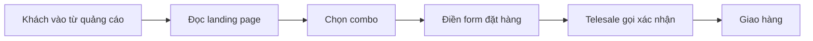

# Tổng quan nghiệp vụ — Landing Page Bán hàng

> Mô tả demo này cho ai, giải quyết vấn đề gì. Cập nhật khi phạm vi thay đổi.

---

## 1. Thông tin chung

| Mục | Nội dung |
| :--- | :--- |
| Tên demo | Landing Page Bán hàng |
| Mã dự án | `retail-landing-page` |
| Ngành / loại khách hàng | Shop bán một sản phẩm chủ lực, chạy quảng cáo (mỹ phẩm, thực phẩm, đồ gia dụng) |
| Loại sản phẩm | Landing page + web quản lý đơn |
| Ý tưởng gốc | 2.2 · Landing page bán 1 sản phẩm (`ZDOCS/02-KE-HOACH/DANH-SACH-Y-TUONG.md`) |
| Người phụ trách | |
| Trạng thái | Mới tạo từ khuôn mẫu |

## 2. Vấn đề của khách hàng

- Chạy quảng cáo nhưng trang đích sơ sài, tỉ lệ chốt đơn thấp
- Đơn đổ về nhiều kênh, khó gom lại
- Không biết nguồn quảng cáo nào ra đơn

## 3. Giải pháp demo thể hiện

- Trang dài thuyết phục: lợi ích, đánh giá, trước và sau, câu hỏi thường gặp
- Đếm ngược khuyến mãi, chọn combo, form đặt hàng COD
- Ghi nhận nguồn đơn (UTM)
- Quản lý đơn, gọi xác nhận, báo cáo theo nguồn và combo

## 4. Vai trò người dùng

| Vai trò | Mã | Dùng trên | Làm được gì |
| :--- | :--- | :--- | :--- |
| Khách | — | Điện thoại | Xem trang, đặt hàng |
| Quản trị viên | ADMIN | Desktop | Toàn quyền |
| Quản lý | MANAGER | Desktop | Nội dung, combo, báo cáo |
| Telesale | STAFF | Desktop | Gọi xác nhận đơn, cập nhật trạng thái |

## 5. Phân hệ và chức năng

| Area | Chức năng | Màn hình (route FE dự kiến) | Ưu tiên |
| :--- | :--- | :--- | :---: |
| `System` | Đăng nhập, tài khoản, vai trò, cài đặt | Có sẵn | — |
| `Cms` | Landing page nhiều khối nội dung | `/` | P1 |
| `Cms` | Đếm ngược, combo giá | `/` | P1 |
| `Sales` | Form đặt hàng COD | `/` (khối cuối trang) | P1 |
| `Sales` | Quản lý đơn, xác nhận | `/admin/orders` | P1 |
| `Sales` | Theo dõi nguồn UTM | `/admin/reports` | P2 |
| `Sales` | Báo cáo đơn theo nguồn, combo | `/admin/reports` | P2 |
| `Cms` | Chỉnh nội dung landing | `/admin/content` | P3 |

P1 = bắt buộc có để demo · P2 = nên có · P3 = làm thêm nếu còn thời gian.

## 6. Luồng nghiệp vụ chính

## 7. Phạm vi

**Có trong demo:**

- Landing page hoàn chỉnh trên điện thoại
- Quản lý đơn và báo cáo theo nguồn

**Không làm (nói rõ với khách nếu được hỏi):**

- Facebook Pixel, Google Ads thật
- Gửi SMS thật
- Các kết nối bên ngoài khác chỉ giả lập

## 8. Dữ liệu mẫu cần chuẩn bị

| Dữ liệu | Số lượng | Ghi chú |
| :--- | :---: | :--- |
| Combo | 3 | Mua 1, mua 2 tặng 1, mua 3 |
| Đánh giá khách hàng | 20 | Có ảnh |
| Đơn hàng | ~600 | 60 ngày, từ nhiều nguồn quảng cáo |
