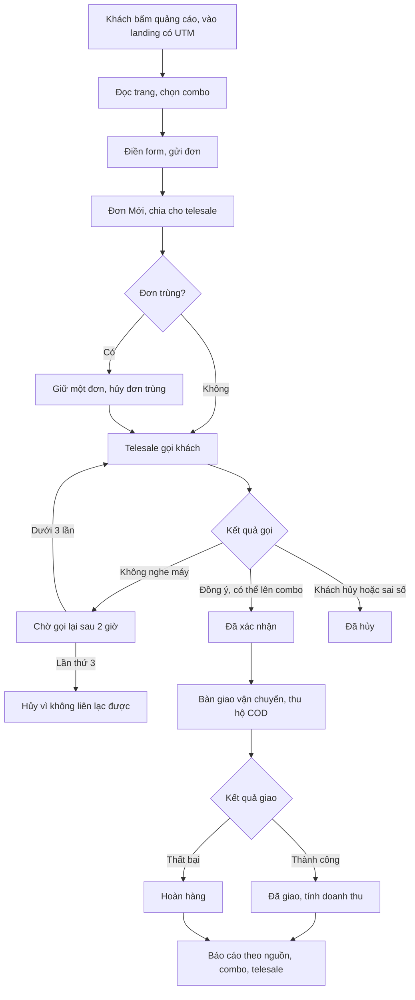
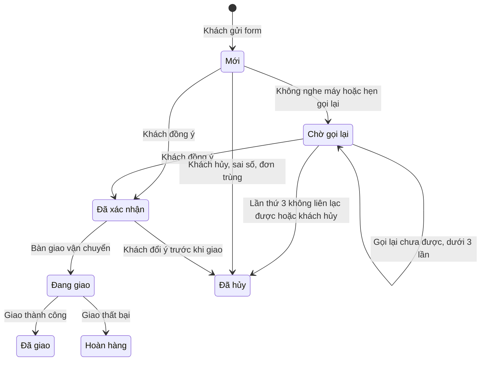

# Đặc tả yêu cầu phần mềm (SRS) — Landing Page Bán hàng

| Phiên bản | Ngày | Trạng thái |
| :--- | :--- | :--- |
| 1.0 | 12/10/2026 | Bản nháp để triển khai demo |

> Cách viết, quy ước mã, mức độ chi tiết: `ZDOCS/05-HUONG-DAN/HUONG-DAN-VIET-TAI-LIEU-NGHIEP-VU.md`.
> Phần nền (đăng nhập, tài khoản, vai trò, cài đặt, đặt lại dữ liệu demo): `ZDOCS/03-KIEN-TRUC/USE-CASE-NEN.md`, không viết lại ở đây.

---

## 1. Giới thiệu

### 1.1. Mục đích

Tài liệu mô tả đầy đủ yêu cầu của bản demo Landing Page Bán hàng: trang đích bán một sản phẩm cho khách vào từ quảng cáo, form đặt hàng COD, quy trình telesale gọi xác nhận, giao hàng và báo cáo hiệu quả theo nguồn quảng cáo. Dev dùng để code, tester dùng để viết và chạy test case, sales dùng để biết demo làm được gì.

### 1.2. Phạm vi

**Trong phạm vi:** landing page nhiều khối nội dung trên điện thoại, đếm ngược khuyến mãi, chọn combo, form đặt hàng COD, trang cảm ơn; ghi nhận nguồn UTM và lượt truy cập; danh sách đơn, chia đơn cho telesale, gọi xác nhận, upsell, xử lý đơn trùng, hủy, bàn giao vận chuyển (giả lập), cập nhật kết quả giao; quản lý combo và thời gian khuyến mãi; tổng quan, báo cáo theo nguồn, combo, telesale; chỉnh nội dung landing và chi phí quảng cáo (P3).

**Ngoài phạm vi:** Facebook Pixel, TikTok Pixel, Google Ads, Conversion API thật (chỉ ghi nhật ký sự kiện giả lập); gửi SMS thật; tổng đài gọi trên web, ghi âm cuộc gọi; API đơn vị vận chuyển thật; thanh toán online; nhiều sản phẩm hoặc nhiều landing; A/B test; kho hàng.

### 1.3. Thuật ngữ

| Thuật ngữ | Giải thích |
| :--- | :--- |
| Landing page | Trang dài bán một sản phẩm, khách vào từ quảng cáo |
| Combo | Gói bán có số lượng, quà tặng và giá riêng, vd "Mua 2 tặng 1" |
| Giá khuyến mãi | Giá combo trong thời gian chương trình khuyến mãi |
| Giá thường | Giá combo ngoài thời gian khuyến mãi, hiển thị gạch ngang khi đang khuyến mãi |
| Chương trình khuyến mãi | Khoảng thời gian áp giá khuyến mãi, có đồng hồ đếm ngược tới lúc kết thúc |
| UTM | Tham số trên link quảng cáo cho biết nguồn (`utm_source`), kênh (`utm_medium`), chiến dịch (`utm_campaign`), nội dung (`utm_content`) |
| Nguồn | Nơi khách đến, đã chuẩn hóa: `facebook`, `tiktok`, `google`, `zalo`, "Trực tiếp" |
| Lượt truy cập | Một trình duyệt vào landing, tính lại sau 30 phút không hoạt động |
| Tỉ lệ chuyển đổi | Số đơn chia cho số lượt truy cập |
| Telesale | Nhân viên gọi điện xác nhận đơn, mã vai trò `STAFF` |
| Chia đơn | Gán người phụ trách gọi cho đơn mới |
| Upsell | Telesale chào khách lên combo hoặc số lượng lớn hơn khi gọi xác nhận |
| Đơn trùng | Các đơn cùng số điện thoại đặt trong 24 giờ, thường do khách bấm gửi nhiều lần |
| Tiền hàng | Giá combo × số lượng, chưa gồm phí vận chuyển |
| Tiền thu hộ | Số tiền đơn vị vận chuyển thu của khách khi giao (COD) |
| Hoàn hàng | Giao thất bại, gói hàng trả về shop |
| Doanh thu đã giao | Tổng tiền hàng của đơn Đã giao, không gồm phí vận chuyển |

### 1.4. Tài liệu liên quan

| Tài liệu | Nội dung |
| :--- | :--- |
| `01-TONG-QUAN-NGHIEP-VU.md` | Tổng quan nghiệp vụ |
| `03-USE-CASE.md` | Đặc tả use case |
| `05-KICH-BAN-KIEM-THU.md` | Test case nghiệm thu |
| `ZDOCS/03-KIEN-TRUC/USE-CASE-NEN.md` | Phần nền dùng chung |

---

## 2. Mô tả tổng quan

### 2.1. Bối cảnh sản phẩm

Shop bán một sản phẩm chủ lực, chạy quảng cáo Facebook, TikTok, Google mỗi ngày, nhận 10–50 đơn COD mỗi ngày. Khách bấm quảng cáo trên điện thoại, đọc trang, để lại tên, số điện thoại, địa chỉ. Đội 2–5 telesale gọi xác nhận trong vòng 15 phút, chào lên combo lớn hơn, chốt đơn rồi gửi hàng qua đơn vị vận chuyển. Chủ shop cần biết mỗi nguồn quảng cáo ra bao nhiêu đơn thật, đã giao được bao nhiêu, telesale nào chốt tốt. Dữ liệu mẫu dùng shop hư cấu "Diệp Lam" bán sản phẩm "Serum Rau Má Phục Hồi 30 ml"; thực phẩm, đồ gia dụng dùng cùng mô hình.

### 2.2. Tác nhân

| Mã vai trò | Tên | Thiết bị | Mục tiêu khi dùng hệ thống |
| :--- | :--- | :--- | :--- |
| — | Khách | Điện thoại | Hiểu nhanh sản phẩm, chọn combo có lợi, đặt hàng trong một phút |
| `ADMIN` | Quản trị viên | Desktop | Cấu hình hệ thống, tài khoản, phân quyền, thông tin shop |
| `MANAGER` | Quản lý | Desktop | Chỉnh combo và khuyến mãi, chia đơn, xem hiệu quả theo nguồn, combo, telesale |
| `STAFF` | Telesale | Desktop | Gọi xác nhận đơn nhanh, upsell, xử lý đơn trùng, cập nhật giao hàng |

Tài khoản demo: `admin`, `quanly`, `nhanvien` (vai trò Telesale). Dữ liệu mẫu có thêm 2 telesale "Phạm Thu Hằng" và "Đỗ Minh Tuấn" để thấy chia đơn và so sánh hiệu quả. Khách không đăng nhập.

### 2.3. Quy trình nghiệp vụ

### 2.4. Giả định và ràng buộc

- Một landing bán một sản phẩm; tối đa 4 combo. Giá đã gồm VAT, là bội số của 1.000 ₫.
- Chỉ nhận COD. Phí vận chuyển đồng giá toàn quốc, không tính theo cân nặng hay vùng.
- Danh mục tỉnh/thành theo sắp xếp đơn vị hành chính năm 2025 (34 tỉnh/thành); địa chỉ chi tiết là ô nhập tự do.
- Telesale gọi bằng điện thoại của mình qua liên kết `tel:`; hệ thống không ghi âm, không kiểm tra cuộc gọi có diễn ra.
- SMS gửi khách, pixel quảng cáo, đơn vị vận chuyển và mã vận đơn đều giả lập; mọi tin và sự kiện giả lập được ghi vào dòng thời gian của đơn hoặc nhật ký sự kiện.
- Giờ làm việc của telesale 8:00–21:00; đơn đến ngoài giờ vẫn nhận và chia bình thường.
- Đồng hồ đếm ngược gắn với thời điểm kết thúc thật của chương trình trên máy chủ, mọi khách thấy cùng một giờ kết thúc. Riêng bản demo bật "tự gia hạn": từ ngày hôm sau ngày kết thúc, máy chủ tự dời thời điểm kết thúc theo chu kỳ 3 ngày để demo mở lúc nào cũng còn khuyến mãi; bản triển khai tắt mặc định.

---

## 3. Yêu cầu chức năng

### 3.1. Tổng quan

| Mã | Yêu cầu | Ưu tiên | Vai trò | UC |
| :--- | :--- | :---: | :--- | :--- |
| FR-01 | Tổng quan hiển thị cho quản lý số liệu hôm nay: lượt truy cập, số đơn, tỉ lệ chuyển đổi, số đơn chờ gọi, tỉ lệ xác nhận, giá trị đơn đã xác nhận, kèm mức tăng giảm so với hôm qua | P1 | MANAGER | UC-10 |
| FR-02 | Tổng quan hiển thị biểu đồ số đơn theo giờ hôm nay, số đơn và tỉ lệ xác nhận 14 ngày, tỉ trọng đơn theo combo và theo nguồn hôm nay | P1 | MANAGER | UC-10 |
| FR-03 | Telesale thấy trên Tổng quan: số đơn Mới chờ mình gọi, số đơn đến giờ gọi lại, số đơn mình đã xác nhận và giá trị upsell hôm nay; bấm thẻ mở danh sách đơn lọc sẵn | P1 | STAFF | UC-10 |

### 3.2. Landing page

| Mã | Yêu cầu | Ưu tiên | Vai trò | UC |
| :--- | :--- | :---: | :--- | :--- |
| FR-04 | Landing hiển thị các khối theo thứ tự: banner chính, vấn đề của khách, công dụng và thành phần, hình trước và sau, đánh giá khách hàng, chứng nhận, cam kết (kiểm hàng, đổi trả, COD), câu hỏi thường gặp, khối combo, form đặt hàng, chân trang có thông tin shop và chính sách đổi trả | P1 | Khách | UC-01 |
| FR-05 | Nút "Đặt hàng ngay" cố định ở cuối màn hình điện thoại; bấm vào thì trang cuộn tới khối combo | P1 | Khách | UC-01 |
| FR-06 | Đồng hồ đếm ngược ở banner và trên form hiển thị thời gian còn lại của chương trình khuyến mãi; hết hạn thì ẩn | P1 | Khách | UC-01 |
| FR-07 | Khối combo hiển thị từng combo: tên, nội dung (số chai, quà tặng), giá khuyến mãi, giá thường gạch ngang, giá mỗi chai, phí vận chuyển hoặc "Miễn phí vận chuyển", nhãn nổi bật; combo mặc định được chọn sẵn | P1 | Khách | UC-01 |
| FR-08 | Khối đánh giá hiển thị điểm trung bình, tổng số đánh giá và 6 đánh giá đầu (ảnh, tên, tỉnh/thành, số sao, nội dung); nút "Xem thêm" hiện thêm 6 đánh giá mỗi lần | P1 | Khách | UC-01 |
| FR-09 | Form đặt hàng gồm họ tên, số điện thoại, tỉnh/thành, địa chỉ chi tiết, combo, số lượng, ghi chú; tổng tiền cập nhật ngay khi đổi combo hoặc số lượng | P1 | Khách | UC-02 |
| FR-10 | Khách bấm "Đặt hàng" thì hệ thống tạo đơn trạng thái Mới, chuyển tới trang cảm ơn hiển thị mã đơn, tóm tắt đơn, lời hẹn gọi xác nhận, và gửi SMS xác nhận (giả lập) | P1 | Khách | UC-02 |
| FR-11 | Hệ thống ghi nhận nguồn, kênh, chiến dịch, nội dung quảng cáo từ UTM, cùng thiết bị và trang giới thiệu khi khách vào landing; gắn vào đơn khi khách đặt | P2 | Hệ thống | UC-02 |
| FR-12 | Hệ thống đếm lượt truy cập landing theo nguồn để tính tỉ lệ chuyển đổi | P2 | Hệ thống | UC-01 |
| FR-13 | Landing hiện thông báo nhỏ về đơn thật gần đây (tên, tỉnh/thành, combo, thời gian) mỗi 15 giây, tối đa 5 lần mỗi lượt xem | P3 | Khách | UC-01 |
| FR-14 | Hệ thống ghi các sự kiện xem trang, bắt đầu điền form, đặt hàng vào nhật ký sự kiện, mô phỏng việc bắn pixel quảng cáo (giả lập) | P3 | Hệ thống | UC-02 |

### 3.3. Combo và nội dung

| Mã | Yêu cầu | Ưu tiên | Vai trò | UC |
| :--- | :--- | :---: | :--- | :--- |
| FR-15 | Quản lý thêm, sửa, ẩn, sắp xếp combo: tên, nội dung, số chai, quà tặng, giá khuyến mãi, giá thường, có miễn phí vận chuyển hay không, nhãn nổi bật, combo mặc định | P2 | MANAGER | UC-11 |
| FR-16 | Quản lý đặt thời điểm bắt đầu và kết thúc chương trình khuyến mãi; landing đếm ngược theo thời điểm kết thúc | P2 | MANAGER | UC-11 |
| FR-17 | Quản lý sửa tiêu đề, đoạn văn, ảnh từng khối; ẩn/hiện và đổi thứ tự khối; xem trước trong khung điện thoại | P3 | MANAGER | UC-13 |
| FR-18 | Quản lý thêm, sửa, ẩn đánh giá khách hàng | P3 | MANAGER | UC-13 |

### 3.4. Đơn hàng và telesale

| Mã | Yêu cầu | Ưu tiên | Vai trò | UC |
| :--- | :--- | :---: | :--- | :--- |
| FR-19 | Danh sách đơn có tab theo trạng thái kèm số đơn; tìm theo số điện thoại, mã đơn, tên; lọc theo ngày đặt, combo, nguồn, telesale phụ trách, nhãn (Trùng, Rủi ro hoàn, Đến giờ gọi lại) | P1 | STAFF, MANAGER | UC-05 |
| FR-20 | Hệ thống tự chia đơn mới cho telesale đang bật "Nhận đơn" theo vòng xoay; telesale bật/tắt "Nhận đơn" và nhận đơn chưa chia; quản lý chia lại đơn cho telesale khác | P2 | MANAGER, STAFF | UC-06 |
| FR-21 | Ngăn chi tiết đơn hiển thị khách, số điện thoại bấm để gọi, địa chỉ, combo, số lượng, tổng tiền, nguồn và chiến dịch, lịch sử cuộc gọi, lịch sử trạng thái, các đơn khác cùng số điện thoại | P1 | STAFF, MANAGER | UC-03 |
| FR-22 | Telesale ghi kết quả mỗi cuộc gọi: Xác nhận, Không nghe máy, Thuê bao không liên lạc được, Sai số, Hẹn gọi lại (chọn giờ), Khách hủy (chọn lý do); mỗi lần gọi lưu thời điểm, người gọi, kết quả, ghi chú | P1 | STAFF | UC-03 |
| FR-23 | Khi xác nhận, telesale sửa được họ tên, địa chỉ, combo, số lượng; hệ thống tính lại tổng tiền và ghi nhận upsell khi tiền hàng tăng | P1 | STAFF | UC-03 |
| FR-24 | Hệ thống gắn nhãn "Trùng" cho các đơn cùng số điện thoại trong 24 giờ; telesale giữ một đơn và hủy đơn còn lại với lý do "Đơn trùng", hoặc bỏ nhãn khi khách thật sự đặt hai đơn | P1 | STAFF | UC-04 |
| FR-25 | Telesale bàn giao đơn Đã xác nhận cho đơn vị vận chuyển (giả lập), từng đơn hoặc nhiều đơn một lần; hệ thống sinh mã vận đơn, chuyển đơn sang Đang giao | P1 | STAFF | UC-07 |
| FR-26 | Telesale cập nhật kết quả giao: Đã giao, hoặc Hoàn hàng kèm lý do | P1 | STAFF | UC-08 |
| FR-27 | Telesale và quản lý hủy đơn chưa bàn giao vận chuyển, bắt buộc chọn lý do | P1 | STAFF, MANAGER | UC-09 |
| FR-28 | Quản lý xuất danh sách đơn đang lọc ra file Excel theo mẫu cột của đơn vị vận chuyển: tên, số điện thoại, địa chỉ, tỉnh/thành, nội dung hàng, tiền thu hộ, ghi chú | P2 | MANAGER | UC-07 |

### 3.5. Báo cáo

| Mã | Yêu cầu | Ưu tiên | Vai trò | UC |
| :--- | :--- | :---: | :--- | :--- |
| FR-29 | Báo cáo theo nguồn: lượt truy cập, số đơn, tỉ lệ chuyển đổi, số đơn xác nhận, tỉ lệ xác nhận, tỉ lệ hoàn, doanh thu đã giao; xem theo nguồn rồi mở xuống từng chiến dịch | P2 | MANAGER | UC-12 |
| FR-30 | Báo cáo theo combo: số đơn, số chai, doanh thu đã giao, tỉ trọng, giá trị trung bình đơn | P2 | MANAGER | UC-12 |
| FR-31 | Báo cáo theo telesale: số đơn được chia, đã gọi, đã xác nhận, tỉ lệ xác nhận, số đơn upsell, giá trị upsell, tỉ lệ hoàn | P2 | MANAGER | UC-12 |
| FR-32 | Báo cáo theo ngày: số đơn, số đơn xác nhận, hủy, hoàn, doanh thu đã giao, so với kỳ liền trước cùng độ dài; kèm thống kê lý do hủy và lý do hoàn | P2 | MANAGER | UC-12 |
| FR-33 | Quản lý nhập chi phí quảng cáo theo ngày và nguồn; báo cáo nguồn hiển thị thêm chi phí mỗi đơn xác nhận và ROAS | P3 | MANAGER | UC-14 |
| FR-34 | Xuất báo cáo đang xem ra file Excel | P3 | MANAGER | UC-12 |

---

## 4. Quy tắc nghiệp vụ

| Mã | Quy tắc | Áp dụng cho |
| :--- | :--- | :--- |
| BR-01 | Giá khuyến mãi và giá thường của combo là bội số của 1.000 ₫, giá khuyến mãi không lớn hơn giá thường. Tối đa 4 combo hiển thị, đúng một combo mặc định. Giá mỗi chai = giá combo / số chai, làm tròn xuống tới 1.000 ₫. Combo đã có đơn không xóa được, chỉ ẩn | FR-07, FR-15 |
| BR-02 | Thời điểm khách gửi form nằm trong [bắt đầu, kết thúc) của chương trình thì đơn dùng giá khuyến mãi, ngoài khoảng đó dùng giá thường. Mức giá (khuyến mãi hay thường) chốt lúc khách gửi form và lưu vào đơn; telesale đổi combo khi xác nhận vẫn dùng mức giá đã chốt | FR-06, FR-09, FR-23 |
| BR-03 | Tiền hàng = giá combo × số lượng. Phí vận chuyển 30.000 ₫ mỗi đơn, đồng giá toàn quốc; miễn phí khi combo có đánh dấu miễn phí vận chuyển hoặc tiền hàng ≥ 500.000 ₫. Tổng tiền = tiền hàng + phí vận chuyển | FR-09, FR-23 |
| BR-04 | Họ tên 2–50 ký tự, không chứa số. Số điện thoại di động 10 số theo mẫu `^0(3\|5\|7\|8\|9)\d{8}$`; nhập dạng `+84` hoặc `84` ở đầu thì tự đổi về `0`. Tỉnh/thành chọn trong danh mục. Địa chỉ chi tiết 10–200 ký tự. Số lượng 1–5. Ghi chú tối đa 300 ký tự | FR-09 |
| BR-05 | Nút "Đặt hàng" khóa từ lúc bấm tới khi có phản hồi. Mỗi trình duyệt gửi tối đa 1 đơn mỗi 60 giây; gửi sớm hơn thì hiện "Bạn vừa đặt hàng, vui lòng chờ 60 giây nếu muốn đặt thêm" | FR-10 |
| BR-06 | Mã đơn: `LP` + `yyMMdd` + số thứ tự 4 chữ số trong ngày, vd `LP2610120042` | FR-10 |
| BR-07 | Nguồn lấy theo lần truy cập gần nhất có UTM, lưu trên trình duyệt 7 ngày. `utm_source` chuyển về chữ thường và gộp tên: `fb`, `facebook` thành `facebook`; `tt`, `tiktok` thành `tiktok`; `gg`, `google` thành `google`; `zl`, `zalo` thành `zalo`; giá trị khác giữ nguyên. Không có UTM thì lấy tên miền trang giới thiệu theo cùng cách gộp (vd `m.facebook.com` thành `facebook`); không có trang giới thiệu thì nguồn là "Trực tiếp" | FR-11 |
| BR-08 | Một trình duyệt tính một lượt truy cập cho tới khi không hoạt động 30 phút. Tỉ lệ chuyển đổi = số đơn (không tính đơn hủy lý do "Đơn trùng") / số lượt truy cập × 100, làm tròn 2 chữ số thập phân; không có lượt truy cập thì hiển thị "—" | FR-01, FR-12, FR-29 |
| BR-09 | Đơn mới chia cho telesale đang bật "Nhận đơn" theo vòng xoay: người được chia đơn lâu nhất nhận trước. Đơn cùng số điện thoại với một đơn còn mở thì chia cho người đang giữ đơn đó. Không ai bật "Nhận đơn" thì đơn ở trạng thái chưa chia; mọi telesale thấy và bấm "Nhận đơn" để giữ | FR-20 |
| BR-10 | Kết quả cuộc gọi quyết định trạng thái: Xác nhận chuyển Đã xác nhận. Không nghe máy hoặc Thuê bao chuyển Chờ gọi lại, hệ thống tự hẹn gọi lại sau 2 giờ. Hẹn gọi lại chuyển Chờ gọi lại với giờ telesale chọn. Sai số chuyển Đã hủy, lý do "Sai số điện thoại". Khách hủy chuyển Đã hủy với lý do khách nêu. Lần thứ 3 không liên lạc được (cộng dồn Không nghe máy và Thuê bao) thì chuyển Đã hủy, lý do "Không liên lạc được" | FR-22 |
| BR-11 | Đơn Chờ gọi lại tới giờ hẹn thì gắn nhãn "Đến giờ gọi lại" và xếp đầu danh sách của telesale phụ trách | FR-03, FR-19 |
| BR-12 | Upsell khi tiền hàng lúc xác nhận lớn hơn tiền hàng lúc khách đặt; giá trị upsell = tiền hàng lúc xác nhận − tiền hàng lúc đặt. Giảm combo hoặc số lượng không tính upsell âm | FR-23, FR-31 |
| BR-13 | Chỉ sửa họ tên, địa chỉ, combo, số lượng khi đơn Mới hoặc Chờ gọi lại. Từ Đã xác nhận trở đi chỉ thêm được ghi chú | FR-23 |
| BR-14 | Đơn mới có cùng số điện thoại với một đơn chưa hủy đặt trong 24 giờ trước thì cả hai gắn nhãn "Trùng". Hủy một đơn với lý do "Đơn trùng" thì nhãn ở đơn còn lại tự bỏ. Bấm "Không phải trùng" thì nhãn bỏ ở cả hai đơn. Đơn hủy lý do "Đơn trùng" không tính vào số đơn, tỉ lệ hủy, tỉ lệ chuyển đổi, tỉ lệ xác nhận | FR-24, FR-29 |
| BR-15 | Khách có từ 2 đơn Hoàn hàng (theo số điện thoại) thì đơn mới của khách gắn nhãn "Rủi ro hoàn" | FR-19, FR-21 |
| BR-16 | Chỉ chuyển trạng thái theo sơ đồ §5.2. Hủy được khi đơn Mới, Chờ gọi lại hoặc Đã xác nhận; lý do bắt buộc: Khách đổi ý, Chê giá cao, Đặt nhầm, Đã mua nơi khác, Đơn trùng, Khác (kèm ghi chú); hệ thống tự dùng "Sai số điện thoại" và "Không liên lạc được". Mỗi lần chuyển ghi người làm, thời điểm, trạng thái trước và sau | FR-22, FR-25, FR-26, FR-27 |
| BR-17 | Đơn vị vận chuyển chọn trong GHN, GHTK, Viettel Post, J&T Express (giả lập). Mã vận đơn giả lập = mã đơn vị (`GHN`, `GHTK`, `VTP`, `JT`) + 10 chữ số. Tiền thu hộ = tổng tiền đơn. Bàn giao nhiều đơn thì bỏ qua đơn không ở trạng thái Đã xác nhận và báo số đơn bị bỏ qua | FR-25 |
| BR-18 | Hoàn hàng bắt buộc chọn lý do: Khách không nghe máy, Khách từ chối nhận, Sai địa chỉ, Khác | FR-26 |
| BR-19 | Tỉ lệ xác nhận = số đơn đã từng xác nhận (Đã xác nhận, Đang giao, Đã giao, Hoàn hàng) / số đơn (không tính "Đơn trùng") × 100. Tỉ lệ hoàn = Hoàn hàng / (Đã giao + Hoàn hàng) × 100. Hai tỉ lệ làm tròn 1 chữ số thập phân. Doanh thu đã giao = Σ tiền hàng của đơn Đã giao, tính theo ngày giao, không gồm phí vận chuyển. Giá trị đơn đã xác nhận = Σ tổng tiền của đơn đã từng xác nhận, tính theo ngày xác nhận | FR-01, FR-29, FR-30, FR-31, FR-32 |
| BR-20 | Đếm ngược tính theo giờ máy chủ, không theo đồng hồ máy khách. Còn từ 24 giờ trở lên thì hiển thị "N ngày hh:mm:ss", dưới 24 giờ hiển thị "hh:mm:ss". Thời điểm kết thúc phải sau thời điểm bắt đầu. Chương trình bật tự gia hạn N ngày (bản demo) thì từ ngày hôm sau ngày kết thúc, thời điểm kết thúc dời thêm N ngày tới khi còn ở tương lai; trong ngày kết thúc không gia hạn | FR-06, FR-16 |
| BR-21 | Thông báo đơn gần đây chỉ lấy đơn thật trong 48 giờ, chưa hủy; hiển thị tên gọi (từ cuối của họ tên), tỉnh/thành, combo, thời gian tương đối, vd "Hoa ở Hà Nội vừa đặt Mua 2 tặng 1 – 12 phút trước"; không hiển thị số điện thoại, địa chỉ | FR-13 |
| BR-22 | Chi phí mỗi đơn xác nhận = chi phí quảng cáo / số đơn xác nhận, làm tròn tới 1.000 ₫. ROAS = doanh thu đã giao / chi phí quảng cáo, làm tròn 2 chữ số thập phân | FR-33 |

---

## 5. Yêu cầu dữ liệu

### 5.1. Thực thể

| Thực thể | Mô tả | Thuộc tính chính | Quan hệ |
| :--- | :--- | :--- | :--- |
| Sản phẩm | Sản phẩm chủ lực của landing | Tên, mô tả ngắn, ảnh, quy cách (30 ml) | Có nhiều combo |
| Combo | Gói bán trên landing | Mã, tên, nội dung, số chai, quà tặng, giá khuyến mãi, giá thường, miễn phí vận chuyển, nhãn, thứ tự, mặc định, trạng thái (hiển thị, ẩn) | Thuộc một sản phẩm; có nhiều đơn |
| Chương trình khuyến mãi | Khoảng thời gian áp giá khuyến mãi | Tên, thời điểm bắt đầu, thời điểm kết thúc | Áp cho mọi combo |
| Khối nội dung | Một khối trên landing | Loại khối, tiêu đề, nội dung, ảnh, thứ tự, hiển thị | — |
| Đánh giá | Đánh giá khách hàng trên landing | Tên, tỉnh/thành, số sao, nội dung, ảnh, hiển thị | — |
| Lượt truy cập | Một phiên xem landing | Mã phiên, thời điểm, nguồn, kênh, chiến dịch, nội dung quảng cáo, thiết bị, trang giới thiệu | Có thể dẫn tới một hoặc nhiều đơn |
| Đơn hàng | Đơn khách gửi từ form | Mã, thời điểm đặt, họ tên, số điện thoại, tỉnh/thành, địa chỉ chi tiết, ghi chú, combo, số lượng, mức giá áp dụng, giá combo, tiền hàng lúc đặt, tiền hàng, phí vận chuyển, tổng tiền, nguồn, kênh, chiến dịch, nội dung quảng cáo, telesale phụ trách, trạng thái, số lần không liên lạc được, giờ hẹn gọi lại, lý do hủy, lý do hoàn, nhãn | Thuộc một lượt truy cập; có nhiều cuộc gọi, nhiều sự kiện; có tối đa một vận đơn |
| Cuộc gọi | Một lần telesale gọi khách | Thời điểm, telesale, kết quả, giờ hẹn, lý do, ghi chú | Thuộc một đơn |
| Sự kiện đơn | Một dòng trên dòng thời gian | Loại (đổi trạng thái, sửa đơn, chia đơn, tin gửi khách), trạng thái trước, trạng thái sau, nội dung, người làm, thời điểm | Thuộc một đơn |
| Vận đơn | Thông tin giao hàng | Đơn vị vận chuyển, mã vận đơn, tiền thu hộ, thời điểm bàn giao, thời điểm giao xong | Thuộc một đơn |
| Trạng thái telesale | Thông tin nhận đơn của tài khoản `STAFF` | Đang bật nhận đơn, thời điểm được chia đơn gần nhất | Thuộc một tài khoản; phụ trách nhiều đơn |
| Sự kiện chuyển đổi (P3) | Nhật ký mô phỏng pixel | Loại sự kiện, thời điểm, mã phiên, mã đơn (nếu có), giá trị | Thuộc một lượt truy cập |
| Chi phí quảng cáo (P3) | Chi tiêu quảng cáo theo ngày | Ngày, nguồn, chiến dịch, số tiền | — |

Đơn lưu tên combo, giá combo và mức giá áp dụng tại thời điểm đặt. Đổi giá combo sau này không làm thay đổi đơn cũ.

### 5.2. Vòng đời

**Đơn hàng**

**Chương trình khuyến mãi:** Sắp chạy (trước thời điểm bắt đầu) → Đang chạy → Đã kết thúc (qua thời điểm kết thúc). Quản lý đổi thời điểm kết thúc thì trạng thái tính lại ngay.

**Combo:** Hiển thị ↔ Ẩn. Combo mặc định không ẩn được; muốn ẩn phải chọn combo mặc định khác trước.

### 5.3. Mã chứng từ

| Chứng từ | Định dạng | Ví dụ |
| :--- | :--- | :--- |
| Đơn hàng | `LP` + `yyMMdd` + 4 số | `LP2610120042` |
| Combo | `C` + 2 số | `C02` |
| Mã vận đơn (giả lập) | Mã đơn vị + 10 số | `GHTK2610124587` |

---

## 6. Báo cáo

| Báo cáo | Chỉ số | Bộ lọc | Vai trò |
| :--- | :--- | :--- | :--- |
| Tổng quan quản lý | Lượt truy cập, số đơn, tỉ lệ chuyển đổi, đơn chờ gọi, tỉ lệ xác nhận, giá trị đơn đã xác nhận so hôm qua; đơn theo giờ; xu hướng 14 ngày; tỉ trọng combo và nguồn | — | MANAGER |
| Tổng quan telesale | Đơn chờ mình gọi, đơn đến giờ gọi lại, đơn mình đã xác nhận, giá trị upsell hôm nay | — | STAFF |
| Theo nguồn | Lượt truy cập, số đơn, tỉ lệ chuyển đổi, đơn xác nhận, tỉ lệ xác nhận, tỉ lệ hoàn, doanh thu đã giao; chi phí, chi phí mỗi đơn xác nhận, ROAS (P3) | Khoảng ngày, nguồn, chiến dịch | MANAGER |
| Theo combo | Số đơn, số chai, doanh thu đã giao, tỉ trọng, giá trị trung bình đơn | Khoảng ngày, nguồn | MANAGER |
| Theo telesale | Đơn được chia, đã gọi, đã xác nhận, tỉ lệ xác nhận, số đơn upsell, giá trị upsell, tỉ lệ hoàn | Khoảng ngày | MANAGER |
| Theo ngày | Số đơn, xác nhận, hủy, hoàn, doanh thu đã giao, so kỳ trước; lý do hủy, lý do hoàn | Khoảng ngày | MANAGER |

---

## 7. Phân quyền

> Quyền nền (`dashboard`, `users`, `roles`, `settings`, `audit-logs`) xem `USE-CASE-NEN.md` §7.

| Mã quyền | Mô tả | ADMIN | MANAGER | STAFF |
| :--- | :--- | :---: | :---: | :---: |
| `orders.view` | Xem đơn chưa chia và đơn mình phụ trách | ✓ | ✓ | ✓ |
| `orders.view-all` | Xem mọi đơn | ✓ | ✓ | |
| `orders.call` | Ghi kết quả gọi, xác nhận, sửa đơn khi xác nhận, xử lý đơn trùng | ✓ | ✓ | ✓ |
| `orders.assign` | Chia lại đơn cho telesale khác | ✓ | ✓ | |
| `orders.cancel` | Hủy đơn chưa bàn giao | ✓ | ✓ | ✓ |
| `orders.ship` | Bàn giao vận chuyển, cập nhật kết quả giao | ✓ | ✓ | ✓ |
| `orders.export` | Xuất Excel danh sách đơn | ✓ | ✓ | |
| `combos.view` | Xem combo và thời gian khuyến mãi | ✓ | ✓ | ✓ |
| `combos.create` / `update` / `delete` | Quản lý combo, thời gian khuyến mãi | ✓ | ✓ | |
| `landing-contents.view` / `update` | Sửa khối nội dung, đánh giá trên landing | ✓ | ✓ | |
| `ad-costs.view` / `create` / `update` | Nhập chi phí quảng cáo | ✓ | ✓ | |
| `reports.view` | Xem báo cáo và số liệu toàn shop ở Tổng quan | ✓ | ✓ | |

Landing page (`/`) và trang cảm ơn (`/cam-on`) công khai, không cần quyền.

---

## 8. Yêu cầu phi chức năng

> Yêu cầu chung (bảo mật JWT, phân quyền, tiếng Việt, chế độ dữ liệu mẫu) theo `ZDOCS/03-KIEN-TRUC/KIEN-TRUC-HE-THONG.md`. Ở đây chỉ ghi yêu cầu riêng của dự án.

| Mã | Yêu cầu |
| :--- | :--- |
| NFR-01 | Landing tối ưu cho điện thoại rộng 360–430 px; nội dung màn hình đầu hiện dưới 2,5 giây trên 4G; dung lượng tải lần đầu không quá 2 MB; ảnh WebP, ảnh dưới màn hình đầu tải lười |
| NFR-02 | Form đặt hàng điền xong dưới 60 giây: ô số điện thoại mở bàn phím số, ô tỉnh/thành có tìm kiếm, lỗi hiện ngay dưới ô khi rời ô |
| NFR-03 | Gửi form phản hồi dưới 1,5 giây; mất mạng thì giữ nguyên dữ liệu đã nhập, báo lỗi rõ, cho gửi lại mà không tạo đơn trùng (mã yêu cầu duy nhất) |
| NFR-04 | Landing render phía máy chủ, có title, meta description, ảnh Open Graph để link chia sẻ qua Facebook, Zalo hiện đúng ảnh và tiêu đề |
| NFR-05 | Màn đơn hàng của telesale: ghi kết quả một cuộc gọi tối đa 3 thao tác; danh sách tự làm mới mỗi 30 giây; đơn mới chia cho mình hiện thông báo kèm âm báo |
| NFR-06 | Nội dung mẫu không đưa cam kết chữa bệnh, không dùng đếm ngược giả (mỗi lượt xem lại đếm từ đầu); thương hiệu shop, sản phẩm, đánh giá mẫu là hư cấu và ghi rõ là dữ liệu minh họa |
| NFR-07 | Dữ liệu mẫu 60 ngày, khoảng 600 đơn và 400–700 lượt truy cập mỗi ngày; nguồn facebook khoảng 55%, tiktok 25%, google 10%, zalo và trực tiếp 10%; tỉ lệ xác nhận 70–80%, tỉ lệ hoàn 10–15%; cao điểm 11–13h và 20–22h |

---

## 9. Danh sách màn hình

| Mã | Màn hình | Route | Vai trò | Thiết bị | UC |
| :--- | :--- | :--- | :--- | :--- | :--- |
| SCR-01 | Landing page | `/` | Khách | Điện thoại | UC-01 |
| SCR-02 | Khối combo và form đặt hàng | `/` (khối cuối trang) | Khách | Điện thoại | UC-01, UC-02 |
| SCR-03 | Trang cảm ơn | `/cam-on` | Khách | Điện thoại | UC-02 |
| SCR-04 | Tổng quan | `/dashboard` | MANAGER, STAFF | Desktop | UC-10 |
| SCR-05 | Danh sách đơn | `/admin/orders` | STAFF, MANAGER | Desktop | UC-04, UC-05, UC-06, UC-07, UC-08, UC-09 |
| SCR-06 | Ngăn chi tiết đơn, ghi kết quả gọi | `/admin/orders` (ngăn bên) | STAFF, MANAGER | Desktop | UC-03, UC-04, UC-08, UC-09 |
| SCR-07 | Combo và thời gian khuyến mãi | `/admin/combos` | MANAGER | Desktop | UC-11 |
| SCR-08 | Báo cáo (tab Nguồn, Combo, Telesale, Theo ngày, Chi phí quảng cáo) | `/admin/reports` | MANAGER | Desktop | UC-12, UC-14 |
| SCR-09 | Nội dung landing, đánh giá | `/admin/content` | MANAGER | Desktop | UC-13 |
