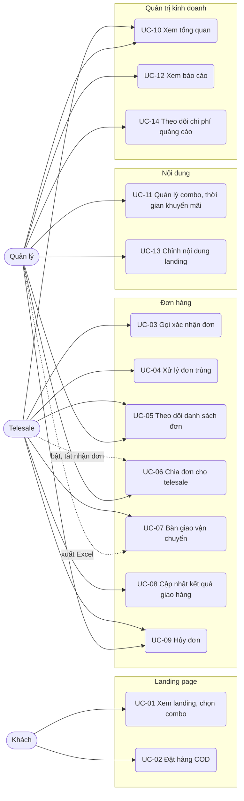
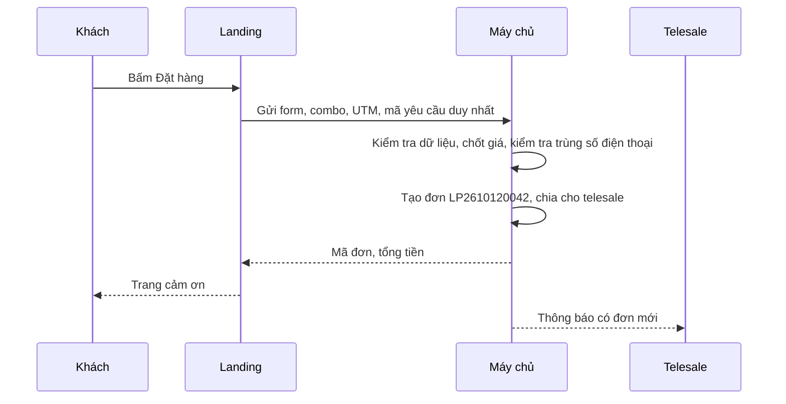

# Đặc tả use case — Landing Page Bán hàng

> Use case phần nền (UC-SYS-01 đến UC-SYS-10): `ZDOCS/03-KIEN-TRUC/USE-CASE-NEN.md`.
> Mã FR, BR, SCR tham chiếu `02-SRS.md`.

---

## 1. Tác nhân

| Tác nhân | Mã vai trò | Use case chính |
| :--- | :--- | :--- |
| Khách | — | UC-01, UC-02 |
| Telesale | `STAFF` | UC-03, UC-04, UC-05, UC-06 (bật/tắt nhận đơn), UC-07, UC-08, UC-09, UC-10 |
| Quản lý | `MANAGER` | UC-05, UC-06, UC-07 (xuất Excel), UC-09, UC-10, UC-11, UC-12, UC-13, UC-14 |
| Quản trị viên | `ADMIN` | Toàn bộ, cộng phần nền |

---

## 2. Sơ đồ use case

---

## 3. Danh sách use case

| Mã | Tên | Tác nhân chính | Module | Ưu tiên | FR |
| :--- | :--- | :--- | :--- | :---: | :--- |
| UC-01 | Xem landing, chọn combo | Khách | Landing page | P1 | FR-04, FR-05, FR-06, FR-07, FR-08, FR-12, FR-13 |
| UC-02 | Đặt hàng COD | Khách | Landing page | P1 | FR-09, FR-10, FR-11, FR-14 |
| UC-03 | Gọi xác nhận đơn | Telesale | Đơn hàng | P1 | FR-21, FR-22, FR-23 |
| UC-04 | Xử lý đơn trùng | Telesale | Đơn hàng | P1 | FR-24 |
| UC-05 | Theo dõi danh sách đơn | Telesale, Quản lý | Đơn hàng | P1 | FR-19 |
| UC-06 | Chia đơn cho telesale | Quản lý | Đơn hàng | P2 | FR-20 |
| UC-07 | Bàn giao vận chuyển | Telesale | Đơn hàng | P1 | FR-25, FR-28 |
| UC-08 | Cập nhật kết quả giao hàng | Telesale | Đơn hàng | P1 | FR-26 |
| UC-09 | Hủy đơn | Telesale, Quản lý | Đơn hàng | P1 | FR-27 |
| UC-10 | Xem tổng quan | Quản lý, Telesale | Quản trị kinh doanh | P1 | FR-01, FR-02, FR-03 |
| UC-11 | Quản lý combo, thời gian khuyến mãi | Quản lý | Nội dung | P2 | FR-15, FR-16 |
| UC-12 | Xem báo cáo | Quản lý | Quản trị kinh doanh | P2 | FR-29, FR-30, FR-31, FR-32, FR-34 |
| UC-13 | Chỉnh nội dung landing | Quản lý | Nội dung | P3 | FR-17, FR-18 |
| UC-14 | Theo dõi chi phí quảng cáo | Quản lý | Quản trị kinh doanh | P3 | FR-33 |

---

## 4. Đặc tả chi tiết

### UC-01: Xem landing, chọn combo

| Mục | Nội dung |
| :--- | :--- |
| Tác nhân chính | Khách |
| Mô tả | Đọc trang bán hàng, xem đánh giá, chọn combo phù hợp |
| Ưu tiên | P1 |
| Điều kiện kích hoạt | Khách bấm quảng cáo hoặc link được chia sẻ |
| Tiền điều kiện | Có ít nhất một combo đang hiển thị |
| Hậu điều kiện | Lượt truy cập và nguồn được ghi nhận; một combo được chọn trên form |
| Yêu cầu liên quan | FR-04 đến FR-08, FR-12, FR-13, BR-01, BR-02, BR-07, BR-08, BR-20, BR-21 |
| Màn hình | SCR-01, SCR-02 |

**Luồng chính**

1. Khách mở landing; hệ thống ghi nhận lượt truy cập và nguồn (BR-07, BR-08).
2. Banner hiện ảnh sản phẩm, tiêu đề, giá "chỉ từ 330.000 ₫/chai", đồng hồ đếm ngược, nút "Đặt hàng ngay".
3. Khách cuộn qua các khối: vấn đề da, công dụng và thành phần, hình trước và sau 28 ngày, đánh giá, chứng nhận, câu hỏi thường gặp.
4. Khách bấm "Đặt hàng ngay" ở thanh cố định cuối màn hình; trang cuộn tới khối combo, combo mặc định đã được chọn.
5. Khách chạm vào combo khác; form bên dưới cập nhật combo và tổng tiền.

**Luồng thay thế**

- 3a. Bấm "Xem thêm" ở khối đánh giá: hiện thêm 6 đánh giá.
- 3b. Bấm một câu hỏi thường gặp: mở câu trả lời, câu đang mở tự đóng.
- 3c. Thông báo đơn gần đây (P3) hiện ở góc dưới màn hình theo BR-21.

**Luồng ngoại lệ**

- E1. Chương trình khuyến mãi đã kết thúc: không hiện đồng hồ đếm ngược; combo hiện giá thường, không có giá gạch ngang (BR-02).
- E2. Ảnh tải chậm: giữ khung đúng kích thước với màu nền, chữ vẫn đọc được, trang không nhảy bố cục.

### UC-02: Đặt hàng COD

| Mục | Nội dung |
| :--- | :--- |
| Tác nhân chính | Khách |
| Mô tả | Điền form và gửi đơn, nhận mã đơn và lời hẹn gọi xác nhận |
| Ưu tiên | P1 |
| Điều kiện kích hoạt | Khách đã chọn combo và bấm "Đặt hàng" |
| Tiền điều kiện | Khách đang ở landing; combo đã chọn đang hiển thị |
| Hậu điều kiện | Đơn Mới có mã theo BR-06, giá chốt theo BR-02, gắn nguồn; được chia cho telesale theo BR-09 |
| Yêu cầu liên quan | FR-09, FR-10, FR-11, FR-14, BR-02 đến BR-07, BR-09, BR-14, BR-15 |
| Màn hình | SCR-02, SCR-03 |

**Luồng chính**

1. Form hiển thị combo đang chọn, số lượng 1 và tổng tiền theo BR-03.
2. Khách nhập họ tên, số điện thoại, chọn tỉnh/thành, nhập địa chỉ chi tiết, chỉnh số lượng nếu cần, ghi chú.
3. Khách bấm "Đặt hàng"; nút khóa, hiện "Đang gửi…".
4. Hệ thống kiểm tra BR-04, chốt mức giá theo BR-02, tính tiền theo BR-03, tạo đơn Mới, gắn nguồn và chiến dịch (BR-07), gắn nhãn "Trùng" hoặc "Rủi ro hoàn" nếu có, chia đơn (BR-09), ghi "Đã gửi SMS xác nhận (giả lập)".
5. Hệ thống chuyển tới trang cảm ơn: mã đơn, combo, tổng tiền, lời nhắn "Nhân viên sẽ gọi xác nhận trong 15 phút, vui lòng để ý điện thoại".

**Luồng thay thế**

- 2a. Khách nhập `+84912345678`: hệ thống tự đổi thành `0912345678`.
- 4a. Đơn gửi ngoài 8:00–21:00: trang cảm ơn ghi "Nhân viên sẽ gọi xác nhận từ 8 giờ sáng".
- 4b. Ghi sự kiện "Đặt hàng" kèm giá trị đơn vào nhật ký sự kiện chuyển đổi (P3, giả lập pixel).

**Luồng ngoại lệ**

- E1. Dữ liệu sai: báo lỗi dưới ô, giữ nguyên dữ liệu đã nhập.
- E2. Gửi đơn mới trong vòng 60 giây từ cùng trình duyệt: hiện thông báo theo BR-05, không tạo đơn.
- E3. Mất mạng khi gửi: giữ dữ liệu, báo "Chưa gửi được đơn, vui lòng thử lại"; gửi lại không tạo đơn trùng (NFR-03).
- E4. Combo vừa bị ẩn: báo "Combo đã thay đổi, vui lòng chọn lại", trang cuộn về khối combo.

### UC-03: Gọi xác nhận đơn

| Mục | Nội dung |
| :--- | :--- |
| Tác nhân chính | Telesale |
| Mô tả | Gọi khách, kiểm tra thông tin, chào lên combo lớn hơn, ghi kết quả cuộc gọi |
| Ưu tiên | P1 |
| Điều kiện kích hoạt | Có đơn Mới hoặc đơn Chờ gọi lại đã tới giờ |
| Tiền điều kiện | Có quyền `orders.call`; đơn Mới hoặc Chờ gọi lại |
| Hậu điều kiện | Cuộc gọi được lưu; đơn chuyển trạng thái theo BR-10 |
| Yêu cầu liên quan | FR-21, FR-22, FR-23, BR-02, BR-03, BR-10 đến BR-13, BR-15 |
| Màn hình | SCR-05, SCR-06 |

**Luồng chính**

1. Telesale mở Đơn hàng, tab Mới, chọn đơn trên cùng; ngăn chi tiết mở bên phải.
2. Telesale bấm số điện thoại để gọi bằng điện thoại của mình; xác nhận tên, địa chỉ, combo với khách.
3. Khách đồng ý; telesale sửa địa chỉ nếu khách đọc lại khác, bấm kết quả "Xác nhận", nhập ghi chú nếu có.
4. Hệ thống lưu cuộc gọi, chuyển đơn sang Đã xác nhận, ghi tin "Đơn đã được xác nhận (SMS giả lập)".

**Luồng thay thế**

- 1a. Đơn Chờ gọi lại tới giờ hẹn: có nhãn "Đến giờ gọi lại" và nằm đầu danh sách (BR-11).
- 3a. Upsell: khách đồng ý lấy combo lớn hơn; telesale đổi combo hoặc số lượng; hệ thống tính lại theo BR-02, BR-03, hiện "Upsell +350.000 ₫"; telesale bấm "Xác nhận".
- 3b. Không nghe máy hoặc thuê bao: telesale chọn kết quả tương ứng; đơn chuyển Chờ gọi lại, giờ hẹn bằng giờ hiện tại cộng 2 giờ, số lần không liên lạc được tăng 1.
- 3c. Khách hẹn gọi lại: chọn "Hẹn gọi lại", chọn giờ; đơn chuyển Chờ gọi lại.
- 3d. Khách không mua: chọn "Khách hủy", chọn lý do; đơn chuyển Đã hủy.
- 3e. Sai số: chọn "Sai số"; đơn chuyển Đã hủy với lý do "Sai số điện thoại".

**Luồng ngoại lệ**

- E1. Lần thứ 3 không liên lạc được: hệ thống tự chuyển đơn sang Đã hủy, lý do "Không liên lạc được" (BR-10).
- E2. Chọn "Khách hủy" mà chưa chọn lý do, hoặc "Hẹn gọi lại" mà chưa chọn giờ: nút lưu bị khóa.
- E3. Đơn có nhãn "Rủi ro hoàn": ngăn chi tiết hiện cảnh báo đỏ kèm danh sách đơn hoàn cũ; telesale vẫn xác nhận được (BR-15).
- E4. Đơn vừa được người khác xử lý hoặc chia lại: khi lưu, hệ thống báo "Đơn đã thay đổi, vui lòng tải lại" và hiện trạng thái mới.

### UC-04: Xử lý đơn trùng

| Mục | Nội dung |
| :--- | :--- |
| Tác nhân chính | Telesale |
| Mô tả | Gộp các đơn khách gửi nhiều lần để không gọi hai lần, không giao trùng |
| Ưu tiên | P1 |
| Điều kiện kích hoạt | Có đơn mang nhãn "Trùng" |
| Tiền điều kiện | Có quyền `orders.call` và `orders.cancel` |
| Hậu điều kiện | Khách chỉ còn một đơn mở; đơn kia Đã hủy với lý do "Đơn trùng" và không tính vào báo cáo |
| Yêu cầu liên quan | FR-24, BR-09, BR-14 |
| Màn hình | SCR-05, SCR-06 |

**Luồng chính**

1. Telesale lọc nhãn "Trùng" hoặc mở một đơn có nhãn; ngăn chi tiết liệt kê các đơn cùng số điện thoại.
2. Telesale gọi khách, hỏi khách muốn giữ đơn nào.
3. Telesale bấm "Hủy đơn trùng" ở đơn khách không giữ.
4. Hệ thống hủy đơn đó với lý do "Đơn trùng", bỏ nhãn ở đơn còn lại.
5. Telesale tiếp tục xác nhận đơn còn lại (UC-03).

**Luồng thay thế**

- 2a. Khách muốn nhận cả hai đơn (vd mua hộ người thân ở địa chỉ khác): telesale bấm "Không phải trùng"; nhãn bỏ ở cả hai đơn, hai đơn tính bình thường.
- 3a. Khách muốn gộp số lượng: telesale sửa số lượng ở đơn giữ lại (BR-13) rồi hủy đơn kia.

**Luồng ngoại lệ**

- E1. Một trong hai đơn đã Đang giao: đơn đó không hủy được; telesale hủy đơn còn lại nếu khách không cần thêm.

### UC-05: Theo dõi danh sách đơn

| Mục | Nội dung |
| :--- | :--- |
| Tác nhân chính | Telesale |
| Tác nhân phụ | Quản lý |
| Mô tả | Xem đơn theo trạng thái, tìm và lọc đơn, mở chi tiết |
| Ưu tiên | P1 |
| Điều kiện kích hoạt | Đầu ca, khi có đơn mới, khi khách gọi lại hỏi đơn |
| Tiền điều kiện | Có quyền `orders.view` |
| Hậu điều kiện | Không thay đổi dữ liệu |
| Yêu cầu liên quan | FR-19, BR-09, BR-11, BR-14, BR-15 |
| Màn hình | SCR-05, SCR-06 |

**Luồng chính**

1. Telesale mở Đơn hàng; hệ thống hiển thị các tab Mới, Chờ gọi lại, Đã xác nhận, Đang giao, Đã giao, Hoàn hàng, Đã hủy, Tất cả kèm số đơn; mặc định tab Mới.
2. Telesale thấy đơn chưa chia và đơn mình phụ trách; quản lý (có `orders.view-all`) thấy tất cả.
3. Mỗi dòng gồm mã đơn, thời điểm đặt (vd "5 phút trước"), khách, số điện thoại, tỉnh/thành, combo × số lượng, tổng tiền, nguồn, telesale, nhãn.
4. Người dùng tìm theo số điện thoại, mã hoặc tên; lọc theo ngày, combo, nguồn, telesale, nhãn.
5. Người dùng chọn một đơn để mở ngăn chi tiết.

**Luồng thay thế**

- 1a. Có đơn mới chia cho mình: thông báo nổi kèm âm báo, số ở tab Mới tăng (NFR-05).
- 2a. Đơn chưa chia: telesale bấm "Nhận đơn" để giữ đơn (BR-09).

**Luồng ngoại lệ**

- E1. Không có đơn khớp bộ lọc: hiển thị trạng thái trống, nút "Xóa bộ lọc".
- E2. Telesale gõ thẳng URL `/admin/reports`: chuyển tới `/forbidden`.

### UC-06: Chia đơn cho telesale

| Mục | Nội dung |
| :--- | :--- |
| Tác nhân chính | Quản lý |
| Tác nhân phụ | Telesale (bật/tắt nhận đơn) |
| Mô tả | Chia đều đơn mới cho telesale đang làm, chia lại khi có người nghỉ |
| Ưu tiên | P2 |
| Yêu cầu liên quan | FR-20, BR-09 |
| Màn hình | SCR-05 |

**Luồng chính**

1. Đầu ca, telesale bật "Nhận đơn" ở đầu trang Đơn hàng; cuối ca tắt.
2. Đơn mới tự chia theo BR-09; dòng thời gian ghi "Chia cho {telesale}".
3. Khi cần, quản lý chọn một hoặc nhiều đơn, bấm "Chia lại", chọn telesale; hệ thống đổi người phụ trách, ghi sự kiện, báo cho telesale mới.

### UC-07: Bàn giao vận chuyển

| Mục | Nội dung |
| :--- | :--- |
| Tác nhân chính | Telesale |
| Tác nhân phụ | Quản lý (xuất Excel) |
| Mô tả | Gửi các đơn đã chốt cho đơn vị vận chuyển (giả lập), lấy mã vận đơn |
| Ưu tiên | P1 |
| Điều kiện kích hoạt | Cuối buổi, gom đơn đã xác nhận để giao kho đóng gói |
| Tiền điều kiện | Có quyền `orders.ship`; có đơn Đã xác nhận |
| Hậu điều kiện | Đơn được chọn chuyển Đang giao, có mã vận đơn và tiền thu hộ |
| Yêu cầu liên quan | FR-25, FR-28, BR-17 |
| Màn hình | SCR-05 |

**Luồng chính**

1. Telesale mở tab Đã xác nhận, đánh dấu các đơn cần gửi.
2. Bấm "Bàn giao vận chuyển", chọn đơn vị vận chuyển.
3. Hệ thống sinh mã vận đơn cho từng đơn, đặt tiền thu hộ bằng tổng tiền (BR-17), chuyển các đơn sang Đang giao, báo "Đã bàn giao N đơn".

**Luồng thay thế**

- 1a. Bàn giao một đơn: mở ngăn chi tiết, bấm "Bàn giao vận chuyển".
- 3a. Quản lý xuất Excel (P2): lọc đơn cần gửi, bấm "Xuất Excel"; file có các cột theo FR-28 để gửi kho hoặc tải lên trang của đơn vị vận chuyển.

**Luồng ngoại lệ**

- E1. Danh sách chọn có đơn không ở trạng thái Đã xác nhận: hệ thống bỏ qua các đơn đó, báo "Đã bàn giao 2 đơn, bỏ qua 1 đơn không ở trạng thái Đã xác nhận".
- E2. Chưa chọn đơn vị vận chuyển: nút "Bàn giao" bị khóa.

### UC-08: Cập nhật kết quả giao hàng

| Mục | Nội dung |
| :--- | :--- |
| Tác nhân chính | Telesale |
| Mô tả | Ghi nhận giao thành công hoặc hoàn hàng |
| Ưu tiên | P1 |
| Điều kiện kích hoạt | Đơn vị vận chuyển báo kết quả; demo do telesale cập nhật tay |
| Tiền điều kiện | Có quyền `orders.ship`; đơn Đang giao |
| Hậu điều kiện | Đơn Đã giao và được tính doanh thu, hoặc Hoàn hàng kèm lý do |
| Yêu cầu liên quan | FR-26, BR-15, BR-18, BR-19 |
| Màn hình | SCR-05, SCR-06 |

**Luồng chính**

1. Telesale mở tab Đang giao, chọn đơn, bấm "Đã giao".
2. Hệ thống hỏi xác nhận, hiện tiền thu hộ.
3. Telesale xác nhận; đơn chuyển Đã giao, doanh thu đã giao ghi nhận vào ngày hôm nay (BR-19).

**Luồng thay thế**

- 1a. Hoàn hàng: telesale bấm "Hoàn hàng", chọn lý do (BR-18); đơn chuyển Hoàn hàng. Khách đủ 2 đơn hoàn thì đơn sau của khách gắn nhãn "Rủi ro hoàn" (BR-15).

**Luồng ngoại lệ**

- E1. Hoàn hàng mà chưa chọn lý do: nút xác nhận bị khóa.
- E2. Đơn chưa ở trạng thái Đang giao: không có nút "Đã giao", "Hoàn hàng".

### UC-09: Hủy đơn

| Mục | Nội dung |
| :--- | :--- |
| Tác nhân chính | Telesale |
| Tác nhân phụ | Quản lý |
| Mô tả | Hủy đơn chưa bàn giao khi khách đổi ý |
| Ưu tiên | P1 |
| Điều kiện kích hoạt | Khách gọi lại xin hủy, hoặc telesale phát hiện đơn không hợp lệ |
| Tiền điều kiện | Có quyền `orders.cancel`; đơn Mới, Chờ gọi lại hoặc Đã xác nhận |
| Hậu điều kiện | Đơn Đã hủy kèm lý do và người hủy |
| Yêu cầu liên quan | FR-27, BR-16 |
| Màn hình | SCR-06 |

**Luồng chính**

1. Người dùng mở đơn, bấm "Hủy đơn".
2. Chọn lý do, nhập ghi chú (bắt buộc khi chọn "Khác").
3. Xác nhận; đơn chuyển Đã hủy, dòng thời gian ghi người hủy, lý do.

**Luồng thay thế**

- 1a. Hủy ngay trong lúc gọi bằng kết quả "Khách hủy" hoặc "Sai số" (UC-03).

**Luồng ngoại lệ**

- E1. Chưa chọn lý do: nút xác nhận bị khóa.
- E2. Đơn từ Đang giao trở đi: không có nút "Hủy đơn"; gọi API hủy trực tiếp bị từ chối với thông báo "Không thể hủy đơn đã bàn giao vận chuyển".

### UC-10: Xem tổng quan

| Mục | Nội dung |
| :--- | :--- |
| Tác nhân chính | Quản lý, Telesale |
| Mô tả | Quản lý nắm hiệu quả quảng cáo hôm nay; telesale biết việc cần gọi |
| Ưu tiên | P1 |
| Tiền điều kiện | Có quyền `dashboard.view`; số liệu toàn shop cần thêm `reports.view` |
| Hậu điều kiện | Không thay đổi dữ liệu |
| Yêu cầu liên quan | FR-01, FR-02, FR-03, BR-08, BR-11, BR-12, BR-19 |
| Màn hình | SCR-04 |

**Luồng chính**

1. Người dùng đăng nhập; hệ thống mở Tổng quan.
2. Với quản lý: 6 thẻ số theo FR-01; biểu đồ đơn theo giờ, xu hướng 14 ngày, tỉ trọng combo và nguồn (FR-02).
3. Với telesale: thẻ đơn chờ gọi, đến giờ gọi lại, đã xác nhận, upsell hôm nay của mình (FR-03).
4. Người dùng bấm một thẻ để mở danh sách đơn lọc sẵn.

**Luồng thay thế**

- 2a. Quản lý bấm một nguồn trong biểu đồ tỉ trọng: mở báo cáo theo nguồn, lọc sẵn nguồn đó.

**Luồng ngoại lệ**

- E1. Hôm nay chưa có lượt truy cập: tỉ lệ chuyển đổi hiển thị "—", không báo lỗi chia cho 0.

### UC-11: Quản lý combo, thời gian khuyến mãi

| Mục | Nội dung |
| :--- | :--- |
| Tác nhân chính | Quản lý |
| Mô tả | Đổi giá, quà tặng, combo mặc định và thời điểm kết thúc khuyến mãi mà không cần sửa code |
| Ưu tiên | P2 |
| Yêu cầu liên quan | FR-15, FR-16, BR-01, BR-02, BR-20 |
| Màn hình | SCR-07 |

**Luồng chính**

1. Quản lý mở Combo; hệ thống hiển thị khung chương trình khuyến mãi (bắt đầu, kết thúc, trạng thái) và danh sách combo với giá khuyến mãi, giá thường, giá mỗi chai, số đơn.
2. Quản lý sửa thời điểm kết thúc hoặc thêm, sửa combo, kéo thả sắp xếp, chọn combo mặc định.
3. Bấm "Lưu"; hệ thống kiểm tra BR-01, BR-20 và lưu.
4. Landing hiển thị combo, giá và đồng hồ đếm ngược mới ở lần tải kế tiếp.

### UC-12: Xem báo cáo

| Mục | Nội dung |
| :--- | :--- |
| Tác nhân chính | Quản lý |
| Mô tả | Biết nguồn, chiến dịch, combo, telesale nào mang lại đơn thật và doanh thu thật |
| Ưu tiên | P2 |
| Yêu cầu liên quan | FR-29, FR-30, FR-31, FR-32, FR-34, BR-08, BR-12, BR-14, BR-19 |
| Màn hình | SCR-08 |

**Luồng chính**

1. Quản lý mở Báo cáo; mặc định tab Nguồn, 7 ngày gần nhất.
2. Hệ thống hiển thị bảng theo nguồn với các chỉ số FR-29; bấm một nguồn để mở xuống từng chiến dịch.
3. Quản lý đổi khoảng ngày (Hôm nay, 7 ngày, 30 ngày, Tháng này, Tùy chọn, tối đa 366 ngày).
4. Quản lý chuyển sang tab Combo, Telesale, Theo ngày.
