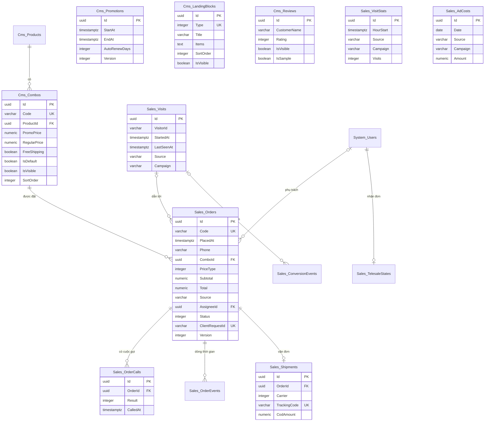

# Thiết kế CSDL — Landing Page Bán hàng

> Database: `WebDemo_RetailLandingPage` (Postgres).
> Quy ước chung và nhóm bảng nền `System_*` (tài khoản, vai trò, quyền, cài đặt, nhật ký): xem `ZDOCS/03-KIEN-TRUC/THIET-KE-CSDL-NEN.md`.
> File này chỉ mô tả **bảng nghiệp vụ riêng của dự án**. Area `Cms` (sản phẩm, combo, khuyến mãi, khối nội dung, đánh giá) và `Sales` (đơn, cuộc gọi, vận đơn, lượt truy cập, chi phí quảng cáo), theo `01-TONG-QUAN-NGHIEP-VU.md` §5.
> Mã FR, BR, TC tham chiếu `02-SRS.md` và `05-KICH-BAN-KIEM-THU.md`. Hợp đồng API, công thức tính tiền, quy ước FE: `07-DANH-SACH-API.md`.

---

## 1. Sơ đồ

`Cms_Promotions` (một dòng), `Sales_AdCosts`, `Sales_VisitStats` không có khóa ngoại. Thông tin shop (tên, hotline, địa chỉ) không có bảng riêng: lưu ở `System_Settings` nhóm "Shop" (§3).

---

## 2. Danh sách bảng

| Bảng | Area | Mô tả | Xóa | Dữ liệu mẫu |
| :--- | :--- | :--- | :--- | :---: |
| `Cms_Products` | Cms | Sản phẩm chủ lực (một dòng) | Không xóa | 1 |
| `Cms_Combos` | Cms | Combo bán trên landing | Mềm; chặn khi đã có đơn (BR-01) | 3 |
| `Cms_Promotions` | Cms | Chương trình khuyến mãi (một dòng) | Không xóa | 1 |
| `Cms_LandingBlocks` | Cms | Khối nội dung landing, mỗi loại một dòng | Không xóa (chỉ ẩn) | 12 |
| `Cms_Reviews` | Cms | Đánh giá khách hàng | Không xóa (chỉ ẩn) | 20 |
| `Sales_Orders` | Sales | Đơn hàng COD | Không xóa | 623 |
| `Sales_OrderCalls` | Sales | Cuộc gọi của telesale | Không xóa | 1.010 |
| `Sales_OrderEvents` | Sales | Dòng thời gian đơn | Không xóa | 4.342 |
| `Sales_Shipments` | Sales | Vận đơn giả lập | Không xóa | 437 |
| `Sales_Visits` | Sales | Lượt truy cập thô (một phiên xem landing) | Không xóa | 0 |
| `Sales_VisitStats` | Sales | Lượt truy cập gộp theo giờ, nguồn, chiến dịch | Không xóa | ≈ 9.680 |
| `Sales_TelesaleStates` | Sales | Trạng thái "Nhận đơn" của telesale | Không xóa | 3 |
| `Sales_ConversionEvents` | Sales | Nhật ký sự kiện pixel giả lập (P3) | Không xóa | 0 |
| `Sales_AdCosts` | Sales | Chi phí quảng cáo theo ngày, nguồn, chiến dịch (P3) | Cứng | 472 |

Số đơn, cuộc gọi, sự kiện, vận đơn là số seeder suy ra từ `FE/src/mock/seed/demo-data.json` (§5); `Sales_VisitStats` ≈ 9.575 dòng lịch sử khác 0 cộng tối đa 120 dòng hôm nay (tùy giờ nạp, §5.5).

---

## 3. Quy ước chung của dự án

- Mọi bảng có cột chung `Id`, `CreatedAt`, `CreatedBy`, `UpdatedAt`, `UpdatedBy` theo `THIET-KE-CSDL-NEN.md` §1; `Cms_Combos` có thêm `IsDeleted`, `Code` unique trên **mọi** dòng (mã combo đã xóa không cấp lại).
- Tiền `numeric(18,2)`, luôn là số nguyên đồng. Giá combo là bội số 1.000 ₫, lớn hơn 0, giá khuyến mãi ≤ giá thường (BR-01). Giá đã gồm VAT (SRS §2.4).
- Thời gian lưu UTC (`timestamptz`). "Ngày" trong mã đơn, báo cáo, Tổng quan, giờ làm việc 8:00–21:00, đếm ngược "23:59:59" tính theo **giờ Việt Nam** (UTC+7 cố định, `VietnamTime` chép từ demo Quản lý Nhà hàng).
- Enum lưu `integer`, API trả chuỗi PascalCase không dấu (bảng tra `07` §2). Chuỗi nguồn (`Source`) lưu chữ thường đã chuẩn hóa theo BR-07; không có nguồn lưu `direct` (hiển thị "Trực tiếp"). Chiến dịch không có lưu chuỗi rỗng `''` ở `Sales_VisitStats`, `Sales_AdCosts` (để làm khóa unique), `null` ở `Sales_Orders`, `Sales_Visits`.
- Người thao tác được chụp vào bản ghi (`…Id` + `…Name` là họ tên) để báo cáo không phụ thuộc tài khoản.
- **Khóa lạc quan**: `Sales_Orders.Version`, `Cms_Promotions.Version` là concurrency token (`IsConcurrencyToken()`), service tăng 1 ở mỗi thay đổi; thao tác đơn gửi `version`, lệch → 409 `DonDaThayDoi` (UC-03 E4, `07` §2.5).
- **Chống trùng** (NFR-03): `Sales_Orders.ClientRequestId` unique (cho phép nhiều null); gửi lại cùng mã trả đơn cũ (`07` §3.6).
- Mã chứng từ sinh trong service, trong transaction (SRS §5.3): đơn `LP` + `yyMMdd` (ngày đặt) + 4 số thứ tự trong ngày (BR-06); combo `C` + 2 số tiếp theo số lớn nhất đã cấp; mã vận đơn giả lập theo `07` §3.4. Trùng mã do hai request cùng lúc thì index unique báo lỗi, service thử lại một lần.
- Đơn, cuộc gọi, sự kiện, vận đơn, lượt truy cập **không bao giờ xóa**. Các bảng `Sales_*` đánh dấu `IAuditLogExempt` (ghi rất nhiều, bản ghi đã tự lưu người và giờ); bảng `Cms_*` và `Sales_AdCosts` ghi nhật ký. Đặt lại dữ liệu demo xóa cứng toàn bộ bảng `Cms_*`, `Sales_*` (bảng con trước) rồi nạp lại.
- Thông tin shop lưu ở `System_Settings` (giá trị mẫu trong `FE/src/mock/seed/project.json`; nhãn, kiểm tra ở `FE/src/config/setting-labels.ts`):

| Khóa | Nhóm | Giá trị mẫu | Ghi chú |
| :--- | :--- | :--- | :--- |
| `Store.Name` | Shop | `Diệp Lam` | Tên shop hư cấu: đầu landing, chân trang, tiêu đề chia sẻ |
| `Store.Tagline` | Shop | `Mỹ phẩm thảo mộc Việt, dịu nhẹ cho làn da nhạy cảm` | Có thể trống |
| `Store.Hotline` | Shop | `0283 8 456 789` | Chân trang, trang cảm ơn |
| `Store.Email` | Shop | `cskh@dieplam.example` | Tên miền `.example` (không có thật) |
| `Store.Address` | Shop | `Tầng 3, 25 Nguyễn Trãi, Phường Bến Thành, TP. Hồ Chí Minh` | Chân trang |
| `Store.WorkingHours` | Shop | `8:00–21:00 hằng ngày` | Chữ hiển thị |
| `Store.BusinessInfo` | Shop | `Hộ kinh doanh Diệp Lam · Giấy chứng nhận đăng ký kinh doanh số minh họa` | Dòng cuối chân trang |

  Logo, màu landing theo `Brand.LogoUrl` (`/logo/logo-mark.svg`), `Brand.PrimaryColor` (`#0F766E`, xanh mòng két, tương phản chữ trắng 5,5:1). `Brand.AppName` = "Landing Page Bán hàng" là tên khu quản trị. Các con số cố định khác (phí vận chuyển 30.000 ₫, ngưỡng miễn phí 500.000 ₫, số lượng 1–5, 60 giây giữa hai đơn, 24 giờ đơn trùng, 2 giờ gọi lại, 3 lần không liên lạc được, 8:00–21:00…) là hằng số trong code: BE `Domain/Entities/Sales/SalesRules.cs`, FE `src/config/sales-rules.ts`, cùng giá trị.
- **Ảnh mẫu**: đường dẫn đầy đủ trong seed, FE phục vụ từ `FE/public/seed/...`: sản phẩm `/seed/product/*.webp`, combo `/seed/combos/c01.webp`…, khối nội dung `/seed/landing/*.webp`, đánh giá `/seed/reviews/avatar-01.webp`… (avatar minh họa, không ảnh người thật), `/seed/reviews/anh-01.webp`… (ảnh khách gửi, không có mặt người), ảnh chia sẻ `/seed/og-landing.jpg` (1200 × 630). Ảnh tải lên qua giao diện dùng `POST /api/uploads/images` của nền, lưu `/uploads/...`.

---

## 4. Mô tả bảng

### `Cms_Products`: sản phẩm

| Cột | Kiểu | Ràng buộc | Ghi chú |
| :--- | :--- | :--- | :--- |
| `Code` | `varchar(20)` | unique | `SP01` |
| `Name` | `varchar(150)` | bắt buộc | "Serum Rau Má Phục Hồi 30 ml"; tiêu đề trang, meta |
| `ShortName` | `varchar(50)` | bắt buộc | "Serum Rau Má", dùng trong câu ngắn |
| `Volume` | `varchar(30)` | bắt buộc | "30 ml" |
| `Unit` | `varchar(20)` | bắt buộc | "chai", hiện "370.000 ₫/chai" |
| `ShortDescription` | `varchar(500)` | bắt buộc | Meta description, ảnh chia sẻ |
| `ImageUrl` | `varchar(500)` | | |

Chỉ một dòng (SRS §1.2: một sản phẩm một landing). Không có API thêm, xóa.

### `Cms_Combos`: combo

| Cột | Kiểu | Ràng buộc | Ghi chú |
| :--- | :--- | :--- | :--- |
| `Code` | `varchar(5)` | unique mọi dòng, `^C\d{2}$` | Cấp tự động `C04`, `C05`… |
| `ProductId` | `uuid` | FK `Cms_Products` | |
| `Name` | `varchar(50)` | bắt buộc | "Mua 2 tặng 1" |
| `Description` | `varchar(200)` | bắt buộc | Nội dung combo trên thẻ |
| `BottleCount` | `integer` | 1–10 | Số chai, tính giá mỗi chai, báo cáo số chai |
| `GiftText` | `varchar(100)` | | Quà tặng, vd "1 sữa rửa mặt Rau Má 100 ml" |
| `PromoPrice` | `numeric(18,2)` | > 0, bội số 1.000, ≤ `RegularPrice` | BR-01 |
| `RegularPrice` | `numeric(18,2)` | > 0, bội số 1.000 | |
| `FreeShipping` | `boolean` | | BR-03 |
| `Badge` | `varchar(30)` | | Nhãn nổi bật "Bán chạy nhất" |
| `ImageUrl` | `varchar(500)` | | |
| `SortOrder` | `integer` | | `PUT /api/combos/order` đánh lại 10, 20, 30… |
| `IsDefault` | `boolean` | đúng một dòng `true` trong combo đang hiện | Đặt combo khác làm mặc định thì dòng cũ tự bỏ (TC-34) |
| `IsVisible` | `boolean` | tối đa 4 dòng `true` | Combo mặc định không ẩn được (SRS §5.2) |
| `IsDeleted` | `boolean` | mặc định 0 | Chỉ khi chưa có đơn (`Sales_Orders.ComboId` hoặc `PlacedComboId`) |

Index `(IsVisible, SortOrder)`.

### `Cms_Promotions`: chương trình khuyến mãi

| Cột | Kiểu | Ràng buộc | Ghi chú |
| :--- | :--- | :--- | :--- |
| `Name` | `varchar(100)` | bắt buộc | "Tuần lễ chăm da rau má" |
| `StartAt` | `timestamptz` | bắt buộc | |
| `EndAt` | `timestamptz` | > `StartAt` (BR-20) | Thời điểm kết thúc quản lý đặt |
| `AutoRenewDays` | `integer` | null hoặc 1–30 | Tự gia hạn cho bản demo (`07` §3.3); null = tắt |
| `Version` | `integer` | concurrency token | |

Một dòng duy nhất. Trạng thái **không lưu**, suy ra mỗi lần đọc từ `StartAt` và `EffectiveEndAt` (`07` §3.3): `SapChay` khi `now < StartAt`, `DangChay` khi `StartAt ≤ now < EffectiveEndAt`, còn lại `DaKetThuc`.

Enum `PromotionStatus` (chỉ trong DTO): `SapChay` Sắp chạy, `DangChay` Đang chạy, `DaKetThuc` Đã kết thúc.

### `Cms_LandingBlocks`: khối nội dung

| Cột | Kiểu | Ràng buộc | Ghi chú |
| :--- | :--- | :--- | :--- |
| `Type` | `integer` | unique | Enum `BlockType`, mỗi loại đúng một khối |
| `Title` | `varchar(150)` | bắt buộc | |
| `Subtitle` | `varchar(300)` | | |
| `Body` | `text` | ≤ 2.000 ký tự | Đoạn văn, xuống dòng giữ nguyên |
| `ImageUrl` | `varchar(500)` | | |
| `CtaText` | `varchar(50)` | | Chữ nút (Hero: "Đặt hàng ngay", Order: "Đặt hàng", Reviews: "Xem thêm") |
| `Items` | `text` (chuỗi JSON) | mảng ≤ 12 phần tử | `ContentItem[]` (`07` §2.4): `{ title?, text?, value?, icon?, imageUrl?, afterImageUrl? }`; lưu chuỗi JSON qua value converter để cấu hình EF trung lập provider (không dùng `jsonb`) |
| `SortOrder` | `integer` | | `Hero` luôn nhỏ nhất, `Footer` luôn lớn nhất |
| `IsVisible` | `boolean` | | `Hero`, `Order`, `Footer` luôn `true` |

Enum `BlockType` (thứ tự mặc định theo FR-04):

| Giá trị | Tên | Hiển thị | Dùng trường |
| :---: | :--- | :--- | :--- |
| 0 | `Hero` | Banner chính | title, subtitle, imageUrl, ctaText; items = 3 ý ngắn có icon; giá "chỉ từ …/chai" và đồng hồ do FE ghép |
| 1 | `Problems` | Vấn đề của khách | items: icon, title, text |
| 2 | `Benefits` | Công dụng | imageUrl; items: icon, title, text |
| 3 | `Ingredients` | Thành phần | body; items: imageUrl, title, value (tên khoa học), text |
| 4 | `Specs` | Thông tin sản phẩm, cách dùng | body = cách dùng; items: title, value |
| 5 | `BeforeAfter` | Trước và sau | body = câu lưu ý; items: title (trước), text (sau), imageUrl, afterImageUrl |
| 6 | `Reviews` | Đánh giá khách hàng | title, subtitle, ctaText; nội dung lấy từ `Cms_Reviews` |
| 7 | `Certificates` | Chứng nhận | items: icon, title, text |
| 8 | `Commitments` | Cam kết | items: icon, title, text |
| 9 | `Faq` | Câu hỏi thường gặp | items: title (câu hỏi), text (trả lời) |
| 10 | `Order` | Combo và form đặt hàng | title, subtitle, body, ctaText; combo lấy từ `Cms_Combos` |
| 11 | `Footer` | Chân trang | title, subtitle, body; items = chính sách (title, text); thông tin shop lấy từ `Store.*` |

### `Cms_Reviews`: đánh giá

| Cột | Kiểu | Ràng buộc | Ghi chú |
| :--- | :--- | :--- | :--- |
| `CustomerName` | `varchar(50)` | bắt buộc | |
| `Province` | `varchar(50)` | trong danh mục 34 tỉnh/thành | |
| `Rating` | `integer` | 1–5 | |
| `Content` | `varchar(1000)` | bắt buộc | |
| `AvatarUrl` | `varchar(500)` | | Avatar minh họa; trống thì FE hiện chữ viết tắt |
| `PhotoUrl` | `varchar(500)` | | Ảnh khách gửi |
| `ReviewedAt` | `timestamptz` | | Ngày đánh giá |
| `SortOrder` | `integer` | | 6 đánh giá đầu theo thứ tự này (FR-08) |
| `IsVisible` | `boolean` | | |
| `IsSample` | `boolean` | | Dữ liệu minh họa: landing hiện chữ "Minh họa" (NFR-06) |

Index `(IsVisible, SortOrder)`. Điểm trung bình, tổng số tính trên đánh giá đang hiện.

### `Sales_Orders`: đơn hàng

| Cột | Kiểu | Ràng buộc | Ghi chú |
| :--- | :--- | :--- | :--- |
| `Code` | `varchar(20)` | unique | `LP` + `yyMMdd` + 4 số (BR-06) |
| `PlacedAt` | `timestamptz` | bắt buộc, index `(PlacedAt)` | Giờ khách gửi form |
| `CustomerName` | `varchar(50)` | 2–50, không có số | BR-04 |
| `Phone` | `varchar(10)` | `^0(3\|5\|7\|8\|9)\d{8}$`, index `(Phone, PlacedAt)` | Đã chuẩn hóa `+84`/`84` → `0` |
| `Province` | `varchar(50)` | trong danh mục | |
| `Address` | `varchar(200)` | 10–200 | |
| `Note` | `varchar(300)` | | Ghi chú của khách |
| `ComboId` | `uuid` | FK `Cms_Combos`, chặn xóa | Combo hiện tại (telesale đổi được, FR-23) |
| `ComboCode`, `ComboName` | `varchar(5)`, `varchar(50)` | | Chụp lúc đặt hoặc lúc đổi |
| `BottleCount` | `integer` | | Chụp số chai của combo |
| `Quantity` | `integer` | 1–5 | |
| `PlacedComboId` | `uuid` | FK `Cms_Combos` | Combo lúc khách đặt (để thấy upsell) |
| `PlacedComboName` | `varchar(50)` | | |
| `PlacedQuantity` | `integer` | | |
| `PriceType` | `integer` | | Enum `PriceType`, chốt lúc gửi form (BR-02) |
| `UnitPrice` | `numeric(18,2)` | | Giá combo theo `PriceType` |
| `PlacedSubtotal` | `numeric(18,2)` | | Tiền hàng lúc đặt (BR-12) |
| `Subtotal` | `numeric(18,2)` | | Tiền hàng hiện tại = `UnitPrice × Quantity` (BR-03) |
| `ShippingFee` | `numeric(18,2)` | 0 hoặc 30.000 | BR-03 |
| `Total` | `numeric(18,2)` | | `Subtotal + ShippingFee`; tiền thu hộ |
| `UpsellAmount` | `numeric(18,2)` | ≥ 0 | Ghi lúc xác nhận: `max(0, Subtotal − PlacedSubtotal)` |
| `VisitorId` | `varchar(64)` | | Mã trình duyệt ẩn danh; index `(VisitorId, PlacedAt)` chặn 60 giây (BR-05) |
| `VisitId` | `uuid` | null, FK `Sales_Visits` | |
| `Source` | `varchar(50)` | bắt buộc, index `(Source, PlacedAt)` | Đã chuẩn hóa (BR-07) |
| `Medium`, `Campaign`, `AdContent` | `varchar(100)` | | `utm_medium`, `utm_campaign`, `utm_content` |
| `Referrer` | `varchar(200)` | | Tên miền trang giới thiệu |
| `Device` | `integer` | | Enum `DeviceType` |
| `AssigneeId` | `uuid` | null, FK `System_Users`, index `(AssigneeId, Status)` | Telesale phụ trách; null = chưa chia |
| `AssigneeName` | `varchar(150)` | | |
| `AssignedAt` | `timestamptz` | null | |
| `Status` | `integer` | index `(Status, PlacedAt)` | Enum `OrderStatus` |
| `FailedCallCount` | `integer` | 0–3 | Cộng dồn Không nghe máy, Thuê bao (BR-10) |
| `NextCallAt` | `timestamptz` | null | Giờ hẹn gọi lại khi `ChoGoiLai` |
| `ConfirmedAt` | `timestamptz` | null | |
| `ConfirmedById`, `ConfirmedByName` | `uuid`, `varchar(150)` | | Báo cáo telesale (FR-31) |
| `CancelReason` | `integer` | null | Enum `CancelReason` |
| `CancelNote` | `varchar(300)` | | Bắt buộc khi `Khac` |
| `CancelledAt`, `CancelledById`, `CancelledByName` | | null | Người hủy (null khi hệ thống tự hủy) |
| `ReturnReason` | `integer` | null | Enum `ReturnReason` |
| `ReturnNote` | `varchar(300)` | | |
| `IsDuplicate` | `boolean` | | Nhãn "Trùng" (BR-14) |
| `DuplicateCleared` | `boolean` | | Đã bấm "Không phải trùng" |
| `IsReturnRisk` | `boolean` | | Nhãn "Rủi ro hoàn" gắn lúc tạo đơn (BR-15) |
| `ClientRequestId` | `varchar(64)` | unique, cho phép nhiều null | `07` §3.6 |
| `Version` | `integer` | concurrency token | |

Nhãn "Đến giờ gọi lại" **không lưu**: `Status = ChoGoiLai` và `NextCallAt ≤ now` (BR-11).

Enum `OrderStatus` (vòng đời SRS §5.2):

| Giá trị | Tên | Hiển thị |
| :---: | :--- | :--- |
| 0 | `Moi` | Mới |
| 1 | `ChoGoiLai` | Chờ gọi lại |
| 2 | `DaXacNhan` | Đã xác nhận |
| 3 | `DangGiao` | Đang giao |
| 4 | `DaGiao` | Đã giao |
| 5 | `HoanHang` | Hoàn hàng |
| 6 | `DaHuy` | Đã hủy |

Enum `PriceType`: `0 KhuyenMai` Giá khuyến mãi, `1 GiaThuong` Giá thường.

Enum `CancelReason`: `0 KhachDoiY` Khách đổi ý, `1 CheGiaCao` Chê giá cao, `2 DatNham` Đặt nhầm, `3 DaMuaNoiKhac` Đã mua nơi khác, `4 DonTrung` Đơn trùng, `5 Khac` Khác, `6 SaiSoDienThoai` Sai số điện thoại (hệ thống), `7 KhongLienLacDuoc` Không liên lạc được (hệ thống).

Enum `ReturnReason`: `0 KhachKhongNgheMay` Khách không nghe máy, `1 KhachTuChoiNhan` Khách từ chối nhận, `2 SaiDiaChi` Sai địa chỉ, `3 Khac` Khác.

Enum `DeviceType`: `0 DienThoai` Điện thoại, `1 MayTinhBang` Máy tính bảng, `2 MayTinh` Máy tính.

### `Sales_OrderCalls`: cuộc gọi

| Cột | Kiểu | Ràng buộc | Ghi chú |
| :--- | :--- | :--- | :--- |
| `OrderId` | `uuid` | FK `Sales_Orders`, index `(OrderId, CalledAt)` | |
| `CalledAt` | `timestamptz` | bắt buộc | |
| `CallerId`, `CallerName` | `uuid`, `varchar(150)` | FK `System_Users` | Index `(CallerId, CalledAt)` cho báo cáo "đã gọi" |
| `Result` | `integer` | | Enum `CallResult` |
| `CallbackAt` | `timestamptz` | null | Giờ hẹn với `HenGoiLai` |
| `CancelReason` | `integer` | null | Với `KhachHuy` |
| `Note` | `varchar(300)` | | |

Enum `CallResult`: `0 XacNhan` Xác nhận, `1 KhongNgheMay` Không nghe máy, `2 ThueBao` Thuê bao không liên lạc được, `3 SaiSo` Sai số, `4 HenGoiLai` Hẹn gọi lại, `5 KhachHuy` Khách hủy.

### `Sales_OrderEvents`: dòng thời gian đơn

| Cột | Kiểu | Ràng buộc | Ghi chú |
| :--- | :--- | :--- | :--- |
| `OrderId` | `uuid` | FK, index `(OrderId, OccurredAt)` | |
| `Type` | `integer` | | Enum `OrderEventType` |
| `FromStatus`, `ToStatus` | `integer` | null | Khi trạng thái đổi (BR-16) |
| `Content` | `varchar(500)` | bắt buộc | Câu hiển thị (mẫu câu `07` §3.8) |
| `ActorId`, `ActorName` | `uuid`, `varchar(150)` | null | null = Hệ thống |
| `OccurredAt` | `timestamptz` | | |

Enum `OrderEventType`: `0 TaoDon` Tạo đơn, `1 ChiaDon` Chia đơn, `2 CuocGoi` Cuộc gọi, `3 DoiTrangThai` Đổi trạng thái, `4 SuaDon` Sửa đơn, `5 TinNhan` Tin gửi khách (SMS giả lập), `6 Nhan` Gắn/bỏ nhãn, `7 BanGiao` Bàn giao vận chuyển, `8 GhiChu` Ghi chú.

### `Sales_Shipments`: vận đơn

| Cột | Kiểu | Ràng buộc | Ghi chú |
| :--- | :--- | :--- | :--- |
| `OrderId` | `uuid` | FK, unique | Tối đa một vận đơn mỗi đơn |
| `Carrier` | `integer` | | Enum `Carrier` |
| `TrackingCode` | `varchar(20)` | unique | `07` §3.4 |
| `CodAmount` | `numeric(18,2)` | | = `Sales_Orders.Total` lúc bàn giao (BR-17) |
| `HandedOverAt` | `timestamptz` | | |
| `HandedOverById`, `HandedOverByName` | | | |
| `DeliveredAt` | `timestamptz` | null, index | Doanh thu đã giao tính theo cột này (BR-19) |
| `ReturnedAt` | `timestamptz` | null, index | |

Enum `Carrier`: `0 GHN` GHN, `1 GHTK` GHTK, `2 VTP` Viettel Post, `3 JT` J&T Express.

### `Sales_Visits`: lượt truy cập (thô)

| Cột | Kiểu | Ràng buộc | Ghi chú |
| :--- | :--- | :--- | :--- |
| `VisitorId` | `varchar(64)` | bắt buộc, index `(VisitorId, LastSeenAt)` | Mã trình duyệt ẩn danh do FE sinh |
| `StartedAt` | `timestamptz` | | |
| `LastSeenAt` | `timestamptz` | | Cập nhật khi tải lại trang, bắt đầu điền form, đặt hàng (BR-08) |
| `Source` | `varchar(50)` | | Nguồn của lượt (BR-07) |
| `Medium`, `Campaign`, `AdContent` | `varchar(100)` | | |
| `Referrer` | `varchar(200)` | | Tên miền |
| `Device` | `integer` | | |
| `Path` | `varchar(200)` | | Đường dẫn không gồm query |

Bảng thô chỉ dùng để gom lượt theo phiên 30 phút và gắn đơn vào lượt; báo cáo đọc `Sales_VisitStats`. Dữ liệu mẫu không có dòng nào (lịch sử nằm ở `Sales_VisitStats`).

### `Sales_VisitStats`: lượt truy cập gộp theo giờ

| Cột | Kiểu | Ràng buộc | Ghi chú |
| :--- | :--- | :--- | :--- |
| `HourStart` | `timestamptz` | unique `(HourStart, Source, Campaign)` | Đầu giờ (UTC, phút = 0) |
| `Source` | `varchar(50)` | | |
| `Campaign` | `varchar(100)` | không null, `''` = không có | |
| `Visits` | `integer` | ≥ 0 | |

Mỗi lượt truy cập **mới** (`07` §3.2) cộng 1 vào dòng của giờ đó (upsert `ON CONFLICT … DO UPDATE SET Visits = Visits + 1`). Báo cáo lượt truy cập, tỉ lệ chuyển đổi đọc bảng này.

### `Sales_TelesaleStates`: nhận đơn

| Cột | Kiểu | Ràng buộc | Ghi chú |
| :--- | :--- | :--- | :--- |
| `UserId` | `uuid` | FK `System_Users`, unique | Tạo khi người có `orders.call` bật "Nhận đơn" lần đầu |
| `IsReceiving` | `boolean` | | |
| `LastAssignedAt` | `timestamptz` | null | Vòng xoay BR-09: nhỏ nhất (null trước) nhận đơn kế tiếp |

### `Sales_ConversionEvents`: sự kiện pixel giả lập (P3)

| Cột | Kiểu | Ràng buộc | Ghi chú |
| :--- | :--- | :--- | :--- |
| `Type` | `integer` | | Enum `ConversionEventType`: `0 PageView`, `1 StartForm`, `2 Purchase` |
| `OccurredAt` | `timestamptz` | index | |
| `VisitorId` | `varchar(64)` | | |
| `VisitId` | `uuid` | null, FK | |
| `OrderId` | `uuid` | null, FK | Với `Purchase` |
| `Source`, `Campaign` | `varchar` | | |
| `Value` | `numeric(18,2)` | null | Tổng tiền đơn với `Purchase` |
| `PixelCall` | `varchar(300)` | | Câu mô phỏng, `07` §3.8 |

### `Sales_AdCosts`: chi phí quảng cáo (P3)

| Cột | Kiểu | Ràng buộc | Ghi chú |
| :--- | :--- | :--- | :--- |
| `Date` | `date` | unique `(Date, Source, Campaign)` | Ngày giờ Việt Nam |
| `Source` | `varchar(50)` | bắt buộc | Chuẩn hóa như BR-07 |
| `Campaign` | `varchar(100)` | không null, `''` = cả nguồn | |
| `Amount` | `numeric(18,2)` | > 0, bội số 1.000 | |

---

## 5. Dữ liệu mẫu

Nguồn duy nhất: `FE/src/mock/seed/demo-data.json` (FE mock nạp trực tiếp; BE nhúng làm EmbeddedResource, đọc bằng `SeedJson`) cùng `project.json` (quyền, tài khoản, cài đặt). Phần `product`, `promotion`, `combos`, `blocks`, `reviews`, `telesales` viết tay; `orders`, `visitStats`, `adCosts` do `FE/scripts/generate-orders.mjs` sinh (`pnpm seed:orders`, hạt giống `20261015`, chạy lại ra đúng file cũ; script giữ nguyên phần viết tay, tự kiểm ràng buộc §5.6 trước khi ghi, kiểm JSON sau khi ghi). File khoảng 250 KB, mỗi đơn một dòng, có trong `.prettierignore`.

**Shop, sản phẩm, đánh giá đều hư cấu**: shop "Diệp Lam", sản phẩm "Serum Rau Má Phục Hồi 30 ml". Nội dung không có cam kết chữa bệnh; khối Trước và sau ghi rõ "Ảnh minh họa… Kết quả khác nhau tùy làn da"; 20 đánh giá có `IsSample = true`, khối đánh giá có dòng "Đánh giá trong bản demo là dữ liệu minh họa" (NFR-06). Telesale: `nhanvien` (Vũ Ngọc Ánh, đang bật Nhận đơn), `nhanvien2` (Phạm Thu Hằng), `nhanvien3` (Đỗ Minh Tuấn) đang tắt.

### 5.1. Số lượng

| Dữ liệu | Số lượng | Đặc điểm |
| :--- | :---: | :--- |
| Sản phẩm | 1 | `SP01` |
| Combo | 3 | `C01` Mua 1 (390.000 / 450.000 ₫, phí ship), `C02` Mua 2 tặng 1 (740.000 / 900.000 ₫, miễn phí ship, mặc định, "Bán chạy nhất"), `C03` Mua 3 (990.000 / 1.350.000 ₫, miễn phí ship, "Tiết kiệm nhất"); chưa có `C04` |
| Chương trình khuyến mãi | 1 | Bắt đầu 00:00:00 ngày −7, kết thúc 23:59:59 ngày +2 (giờ VN, tính lúc nạp), tự gia hạn 3 ngày |
| Khối nội dung | 12 | Đủ 12 loại, đang hiện cả 12, thứ tự 10…120 theo bảng `BlockType` |
| Đánh giá | 20 | Có avatar minh họa, 8 đánh giá có ảnh khách gửi; 16 × 5 sao, 4 × 4 sao → **4,8 / 20 đánh giá**; ngày đánh giá 2–55 ngày trước |
| Đơn | 623 | 609 lịch sử (59 ngày trước hôm nay, gồm 21 đơn trùng và 2 đơn của Lê Thị Hoa) + 14 viết tay (13 đơn trong 8 giờ gần nhất + 1 đơn 30 giờ trước) |
| Cuộc gọi | 1.010 | |
| Sự kiện đơn | 4.342 | Suy ra theo §5.4 |
| Vận đơn | 437 | |
| Lượt truy cập gộp | 600 dòng JSON | 590 dòng lịch sử (59 ngày × 10 cặp nguồn–chiến dịch × 24 giờ) + 10 dòng hôm nay (12 khung giờ gần nhất); ≈ 556 lượt mỗi ngày (429–700) |
| Chi phí quảng cáo | 472 | 59 ngày × 8 chiến dịch trả phí |
| Trạng thái telesale | 3 | |

Cặp nguồn–chiến dịch: `facebook` (`serum_t10`, `serum_review`, `retarget_7d`, không chiến dịch qua `m.facebook.com`/`l.facebook.com`), `tiktok` (`tt_video_ugc`, `tt_spark`), `google` (`gg_search_serum`, `gg_pmax`), `zalo` (`zalo_oa_t10`), `direct`. Cao điểm 11–13h và 20–22h (NFR-07). Mọi đơn mẫu dùng giá khuyến mãi (shop chạy khuyến mãi liên tục).

### 5.2. Cấu trúc file và cách seeder suy ra trường

| Phần | Trường trong file | Seeder và FE mock suy ra |
| :--- | :--- | :--- |
| `product` | `code`, `name`, `shortName`, `volume`, `unit`, `shortDescription`, `imageUrl` | Một dòng `Cms_Products` |
| `promotion` | `name`, `startDay`, `endDay`, `autoRenewDays` | `StartAt` = 00:00:00 giờ VN của ngày `startDay` (so với hôm nay), `EndAt` = 23:59:59 giờ VN của ngày `endDay`; `Version = 1` |
| `combos[]` | `code`, `name`, `description`, `bottleCount`, `giftText`, `promoPrice`, `regularPrice`, `freeShipping`, `badge`, `isDefault`, `imageUrl` | `ProductId` = sản phẩm; `SortOrder` = (chỉ số + 1) × 10; `IsVisible = true` |
| `blocks[]` | `type`, `title`, `subtitle`, `body`, `imageUrl`, `ctaText`, `items` | `SortOrder` = (chỉ số + 1) × 10; `IsVisible = true` |
| `reviews[]` | `name`, `province`, `rating`, `daysAgo`, `avatarUrl`, `photoUrl`, `content` | `ReviewedAt` = `daysAgo` ngày trước lúc 10:00 giờ VN; `SortOrder` = (chỉ số + 1) × 10; `IsVisible = true`; `IsSample = true` |
| `telesales[]` | `username`, `isReceiving` | `LastAssignedAt` = `AssignedAt` lớn nhất của đơn người đó phụ trách |
| `orders[]` | Khóa gọn §5.4 | §5.4 |
| `visitStats[]` | §5.5 | §5.5 |
| `adCosts[]` | `[d, nguồn, chiến dịch, số tiền]` | `Date` = hôm nay + `d` (giờ VN) |

Id ở FE mock cố định qua mỗi lần nạp: `stableId('product', code)`, `stableId('combo', code)`, `stableId('promotion', 1)`, `stableId('block', type)`, `stableId('review', chỉ số)`, `stableId('order', chỉ số trong file)` (mã `LP` phụ thuộc ngày nạp nên không dùng làm khóa), `stableId('call', chỉ số đơn, thứ tự)`, `stableId('event', chỉ số đơn, thứ tự)`, `stableId('visit-stat', hourStart, nguồn, chiến dịch)`, `stableId('ad-cost', d, nguồn, chiến dịch)`, `stableId('telesale', username)`. BE sinh `Guid` mới. Mọi tên đăng nhập trong file (`as`) được tra ra `Id`, họ tên trong `System_Users`.

### 5.3. Thời gian tương đối

- `now` = thời điểm nạp seed, **làm tròn xuống tới phút**. Ngày "hôm nay" theo giờ Việt Nam.
- Đơn có `d` (−59…−1): `t` là `"HH:mm"` giờ Việt Nam của ngày hôm nay + `d`. Đơn không có `d`: `t` là số phút so với `now` (âm là quá khứ), vd `-8` là 8 phút trước. Nạp trước 08:00 thì một phần đơn "hôm nay" rơi sang hôm qua (giống demo Menu QR).
- Mọi mốc khác của đơn (`cl`, `x`, `sh`, `dl`, `rt`, giờ hẹn) là **số phút sau `PlacedAt`**.
- Script đã cắt mọi việc của đơn lịch sử xảy ra từ 00:00 hôm nay, nên lúc nạp không có mốc nào nằm trong tương lai (trừ giờ hẹn gọi lại).
- Không gắn thứ trong tuần: số đơn mỗi ngày dao động nhẹ và tăng dần về gần hôm nay.
- **FE mock tự làm mới dữ liệu khi sang ngày mới** (giờ VN so với ngày nạp, `07` §4.8): demo công khai mở lại hôm sau vẫn có đơn "hôm nay" và đồng hồ đếm ngược còn hạn.

### 5.4. Khóa gọn của đơn

Mỗi đơn một dòng JSON:

| Khóa | Ý nghĩa | Ví dụ |
| :--- | :--- | :--- |
| `d` | Ô ngày (§5.3); vắng = giờ tương đối theo phút | `-12` |
| `t` | Giờ đặt | `"11:42"`, `-8` |
| `n`, `p`, `pv`, `a` | Họ tên, số điện thoại, tỉnh/thành, địa chỉ | |
| `nt` | Ghi chú của khách | `"Giao giờ hành chính"` |
| `cb`, `q` | Mã combo, số lượng lúc đặt | `"C01"`, `1` |
| `pt` | `"T"` = giá thường; vắng = giá khuyến mãi | |
| `u` | UTM đã chuẩn hóa `[nguồn, kênh?, chiến dịch?, nội dung?]` | `["facebook","cpc","serum_t10","video_a"]` |
| `rf` | Tên miền trang giới thiệu khi không có `u` | `"m.facebook.com"` |
| `dv` | `"B"` máy tính bảng, `"M"` máy tính; vắng = điện thoại | |
| `as` | Telesale phụ trách (tên đăng nhập); vắng = chưa chia | `"nhanvien"` |
| `cl` | Cuộc gọi `[phút, mã kết quả, phụ?, ghi chú?]`, người gọi = `as` | `[[16,"KNM"],[146,"XN"]]` |
| `ch` | Đổi combo khi xác nhận `[mã combo, số lượng]` | `["C02",1]` |
| `x` | Hủy bằng thao tác Hủy đơn `[lý do, phút, ghi chú?]`, người hủy = `as` | `["DonTrung",18]` |
| `sh` | Bàn giao `[đơn vị, phút]`, người bàn giao = `as` | `["GHTK",1526]` |
| `dl` | Phút giao thành công | `4613` |
| `rt` | Hoàn hàng `[lý do, phút, ghi chú?]` | `["SaiDiaChi",7302]` |
| `tg` | Nhãn lưu lúc nạp: `"T"` Trùng, `"R"` Rủi ro hoàn | `["R"]` |

Mã kết quả gọi: `XN` Xác nhận, `KNM` Không nghe máy, `TB` Thuê bao, `SS` Sai số, `HGL` Hẹn gọi lại (phụ = phút hẹn sau `PlacedAt`), `KH` Khách hủy (phụ = tên `CancelReason`, `Khac` kèm ghi chú).

Quy tắc suy ra (seeder BE và FE mock giống hệt):

1. **Đơn**: `PlacedAt` theo §5.3. Nguồn: `u[0]`; không có `u` mà có `rf` → chuẩn hóa tên miền theo BR-07 (`m.facebook.com` → `facebook`), `Referrer = rf`; không có cả hai → `direct`. `Medium`, `Campaign`, `AdContent` = `u[1..3]`. `PlacedComboId`, `PlacedComboName`, `PlacedQuantity` theo `cb`, `q`; `PriceType` theo `pt`; `UnitPrice` = giá combo theo `PriceType` (giá seed hiện tại); `PlacedSubtotal = UnitPrice × q`. Có `ch` → `ComboId`, `Quantity` theo `ch` và `UnitPrice` tính lại cùng `PriceType`, không có thì như lúc đặt. `Subtotal`, `ShippingFee`, `Total` theo `07` §3.1. `VisitorId`, `VisitId`, `ClientRequestId` null; `Device` theo `dv`.
2. **Chia đơn**: `as` có → `AssigneeId`, `AssigneeName`, `AssignedAt = PlacedAt`.
3. **Cuộc gọi** theo thứ tự trong `cl`, áp đúng BR-10: `KNM`/`TB` cộng `FailedCallCount`, lần thứ 3 → `DaHuy` lý do `KhongLienLacDuoc` (`CancelledAt` = giờ gọi, người hủy null); còn lại → `ChoGoiLai`, `NextCallAt` = giờ gọi + 120 phút. `HGL` → `ChoGoiLai`, `NextCallAt` = `PlacedAt` + phụ. `SS` → `DaHuy` `SaiSoDienThoai`. `KH` → `DaHuy` với lý do phụ, `CancelNote` = ghi chú. `XN` → `DaXacNhan`, `ConfirmedAt`, `ConfirmedBy` = `as`, `NextCallAt` null, `UpsellAmount = max(0, Subtotal − PlacedSubtotal)`.
4. **Hủy** `x` → `DaHuy`, `CancelReason`, `CancelNote`, `CancelledAt`, người hủy = `as`.
5. **Vận đơn** `sh` → `DangGiao`; `Sales_Shipments`: `Carrier`, `TrackingCode` = mã đơn vị + 10 chữ số cuối của mã đơn (vd đơn `LP2609150004` bàn giao GHTK → `GHTK2609150004`), `CodAmount = Total`, `HandedOverAt`, người = `as`. `dl` → `DaGiao`, `DeliveredAt`. `rt` → `HoanHang`, `ReturnedAt`, `ReturnReason`, `ReturnNote`.
6. **Nhãn**: `IsDuplicate` = có `"T"`, `IsReturnRisk` = có `"R"`, `DuplicateCleared = false`.
7. **Mã đơn**: sắp mọi đơn theo (`PlacedAt`, chỉ số trong file), đánh số 0001… trong mỗi ngày giờ VN.
8. **Sự kiện** (`Sales_OrderEvents`), theo thứ tự thời gian, câu đúng mẫu `07` §3.8:
   - Lúc đặt: `TaoDon` (người null, `ToStatus = Moi`); `TinNhan` "Đã gửi SMS xác nhận (giả lập)"; mỗi nhãn trong `tg` một `Nhan` ("Gắn nhãn Trùng" / "Gắn nhãn Rủi ro hoàn"); có `as` thì `ChiaDon` "Chia cho {họ tên}" (người null).
   - Mỗi cuộc gọi: nếu là `XN` có `ch` thì trước đó một `SuaDon`; rồi `CuocGoi` có `FromStatus`, `ToStatus` khi trạng thái đổi, người = `as`; `XN` thêm `TinNhan` "Đơn đã được xác nhận (SMS giả lập)".
   - `x` → `DoiTrangThai` "Hủy đơn: {lý do}"; `sh` → `BanGiao`; `dl` → `DoiTrangThai` "Giao thành công"; `rt` → `DoiTrangThai` "Hoàn hàng: {lý do}". Người = `as`.
9. **Trạng thái telesale**: theo `telesales[]`, `LastAssignedAt` = `AssignedAt` lớn nhất.

### 5.5. Lượt truy cập và chi phí quảng cáo

- Lịch sử: `{ "d": -59, "s": "facebook", "c": "serum_t10", "h": [24 số] }`; `h[k]` là số lượt từ k:00 tới k:59 giờ VN của ngày `d`. Seeder chỉ chèn giờ có số > 0: `HourStart` = k:00 giờ VN đổi ra UTC.
- Hôm nay: `{ "s", "c", "r": [12 số] }`; `r[i]` là số lượt của **giờ đồng hồ thứ i tính lùi từ giờ hiện tại** (`i = 0` là giờ đang chạy): `HourStart = floor_giờ(now) − i giờ`. Trùng khóa với một dòng lịch sử (nạp trước 11:00 thì vài khung rơi sang hôm qua) thì **cộng dồn**.
- `adCosts`: `[d, nguồn, chiến dịch, số tiền]`, bội số 1.000 ₫; chỉ chiến dịch trả phí (không có `facebook` không chiến dịch và `direct`); hôm nay chưa có chi phí (quản lý nhập, UC-14).

### 5.6. Trạng thái lúc nạp và ràng buộc test (05-KICH-BAN-KIEM-THU §1)

| Đơn | Trạng thái lúc nạp | Điểm cần có |
| :--- | :--- | :--- |
| Lê Thị Hoa `0987654321` | 2 đơn Hoàn hàng (ngày −26 `C01` "Khách từ chối nhận", ngày −13 `C02` "Khách không nghe máy") + 1 đơn `C02` đặt 30 giờ trước | Đơn 30 giờ trước: Chờ gọi lại, 1 lần không nghe máy, hẹn gọi lại lúc 20 phút trước (**Đến giờ gọi lại**), nhãn **Rủi ro hoàn**, phụ trách `nhanvien` (TC-18, demo bước 8) |
| Nguyễn Văn Nam `0912000111` | Chờ gọi lại, đặt 300 phút trước, `C01` × 1 | **2 lần Không nghe máy**, hẹn gọi lại 30 phút trước, phụ trách `nhanvien` (TC-15, TC-21) |
| Lương Thị Mỹ Duyên | Mới, **chưa chia**, 95 phút trước, `zalo` | Telesale bấm "Nhận đơn" (BR-09) |
| 3 đơn Mới của `nhanvien` | 8, 15, 27 phút trước | `facebook`/`serum_t10`, `tiktok`, `google` |
| Đơn `C01` → `C02` 180 phút trước, `C02` → `C03` 480 phút trước | Đã xác nhận, upsell +350.000 ₫ và +250.000 ₫ | Tổng quan telesale có upsell sẵn |
| 7 đơn Đã xác nhận của `nhanvien` (4 hôm qua, 3 hôm nay) | Chưa bàn giao | Demo bước 9 bàn giao nhiều đơn |
| 8 đơn Đang giao của `nhanvien` | Bàn giao 1–3 ngày trước | Demo bước 9 "Đã giao", "Hoàn hàng" |

Số đối chiếu ngay sau khi nạp (giờ nạp từ 08:00 tới 23:59, giờ VN):

- **Telesale `nhanvien`** (FR-03): đơn Mới chờ mình gọi **4** (3 hôm nay + 1 đơn khuya hôm qua), đơn chưa chia **1**, đến giờ gọi lại **3** (Nguyễn Văn Nam, Lê Thị Hoa, Vương Kim Oanh), hẹn gọi sau **1**, mình đã xác nhận hôm nay **3**, upsell hôm nay **2 đơn / 600.000 ₫**. Tab Mới của `nhanvien` có **5** đơn (4 của mình + 1 chưa chia).
- **Quản lý** (FR-01): đơn hôm nay **13**; đơn chờ gọi (Mới + Chờ gọi lại, toàn shop) **10**; đơn hôm nay đã từng xác nhận **5** → tỉ lệ xác nhận **38,5%**; giá trị đơn đã xác nhận hôm nay **3.670.000 ₫** (740.000 + 740.000 + 780.000 + 990.000 + 420.000). Lượt truy cập hôm nay phụ thuộc giờ nạp (tối đa 392 trong 12 khung giờ).
- Không đơn nào còn nhãn "Trùng" lúc nạp; đúng 1 đơn có nhãn "Rủi ro hoàn".
- `0901000001`–`0901000019`, `0901000088` không có trong dữ liệu; chưa có số nào bắt đầu `090100`.

Script kiểm và dừng nếu sai: tổng đơn 560–660; tỉ lệ xác nhận 70–80%; tỉ lệ hoàn 10–15%; facebook 50–60% số đơn; mỗi ngày 380–720 lượt; số điện thoại, địa chỉ, số lượng đúng BR-04; không quá 3 lần không liên lạc được; số test không có; Lê Thị Hoa đủ 3 đơn và 2 đơn hoàn; Nguyễn Văn Nam Chờ gọi lại sau 2 cuộc gọi.

### 5.7. Kết quả chạy script lần gần nhất

| Chỉ số | Giá trị |
| :--- | :--- |
| Đơn lịch sử theo trạng thái | Đã giao 365, Hoàn hàng 49, Đã hủy 164, Đang giao 22, Đã xác nhận 7, Chờ gọi lại 1, Mới 1 (tổng 609) |
| Đơn tính (bỏ 21 đơn hủy "Đơn trùng") | **588**; đã từng xác nhận **443 (75,3%)**; giao 365, hoàn 49 → tỉ lệ hoàn **11,8%** |
| Đơn theo nguồn | facebook 318 (54,1%), tiktok 147 (25,0%), google 61 (10,4%), direct 33 (5,6%), zalo 29 (4,9%) |
| Lượt truy cập lịch sử | **32.924** (trung bình 558/ngày) → tỉ lệ chuyển đổi 59 ngày **1,79%** |
| Doanh thu đã giao lịch sử | **255.070.000 ₫** (Σ tiền hàng 365 đơn, không gồm phí ship) |
| Chi phí quảng cáo | **62.812.000 ₫** → ROAS chung **4,06** |
| Upsell | 100 đơn, **33.020.000 ₫** |
| Lý do hủy | Không liên lạc được 55, Khách đổi ý 30, Sai số điện thoại 22, Đơn trùng 21, Chê giá cao 11, Đã mua nơi khác 11, Đặt nhầm 7, Khác 7 |

| Nguồn | Lượt | Đơn | Chuyển đổi | Xác nhận | Giao | Hoàn (tỉ lệ) | Doanh thu đã giao | Chi phí | ROAS |
| :--- | ---: | ---: | ---: | ---: | ---: | ---: | ---: | ---: | ---: |
| facebook | 17.741 | 318 | 1,79% | 244 (76,7%) | 203 | 24 (10,6%) | 139.670.000 | 36.658.000 | 3,81 |
| tiktok | 9.909 | 147 | 1,48% | 108 (73,5%) | 83 | 18 (17,8%) | 58.270.000 | 15.479.000 | 3,76 |
| google | 1.979 | 61 | 3,08% | 44 (72,1%) | 37 | 5 (11,9%) | 26.250.000 | 7.584.000 | 3,46 |
| direct | 2.315 | 33 | 1,43% | 27 (81,8%) | 25 | 1 (3,8%) | 19.120.000 | 0 | — |
| zalo | 980 | 29 | 2,96% | 20 (69,0%) | 17 | 1 (5,6%) | 11.760.000 | 3.091.000 | 3,80 |

| Telesale | Được chia | Xác nhận | Upsell | Giao | Hoàn |
| :--- | ---: | ---: | :--- | ---: | ---: |
| `nhanvien` Vũ Ngọc Ánh | 289 | 226 (78,2%) | 48 đơn / 15.340.000 ₫ | 189 | 25 (11,7%) |
| `nhanvien2` Phạm Thu Hằng | 155 | 125 (80,6%) | 40 đơn / 14.000.000 ₫ | 104 | 13 (11,1%) |
| `nhanvien3` Đỗ Minh Tuấn | 144 | 92 (63,9%) | 12 đơn / 3.680.000 ₫ | 72 | 11 (13,3%) |

Bảng trên tính trên **609 đơn lịch sử** (ngày −59…−1, theo ngày đặt; doanh thu theo trạng thái lúc nạp), chưa gồm 14 đơn viết tay. BE và FE đối chiếu bằng `GET /api/reports/sources?from={hôm nay − 59}&to={hôm nay − 1}`: lượt, xác nhận, giao, hoàn, doanh thu đã giao, chi phí từng nguồn phải khớp đúng bảng (mọi đơn giao trong khoảng đó đều đặt từ ngày −59, nên lọc doanh thu theo ngày giao vẫn ra cùng số). Riêng **số đơn** của báo cáo lớn hơn bảng 1: đơn viết tay của Lê Thị Hoa đặt 30 giờ trước luôn rơi vào ngày −1 (nạp từ 06:00), Chờ gọi lại, nguồn `facebook`, phụ trách `nhanvien`. Báo cáo ra **589 đơn**, tỉ lệ xác nhận **75,2%**, facebook **319 đơn**; báo cáo telesale `nhanvien` được chia **290**, xác nhận 226 (**77,9%**); mọi số khác giữ nguyên (test BE `SeedTests`).
